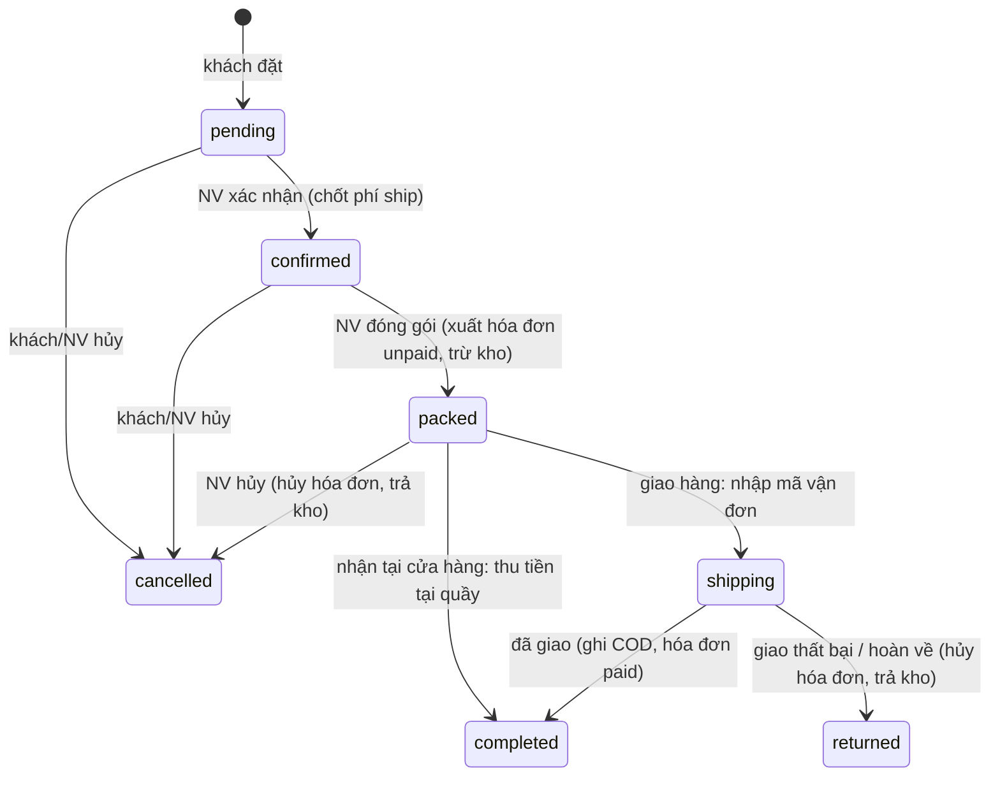

# Checkout shop online

Kế hoạch ngày 13/10/2026 cho luồng mua hàng của shop công khai: giỏ hàng, địa chỉ, phí vận chuyển GHN, thanh toán, tạo đơn, xử lý đơn ở admin và trang theo dõi đơn. Đi sau POS (PR #43, #54), kho theo lô (PR #44), biến thể (PR #46) và module sản phẩm (PR #64 đến #70), đều đã merge. Tham khảo bản nghiên cứu [thanh-toan-van-chuyen.md](thanh-toan-van-chuyen.md) (SePay + GHN).

**Tiến độ:** kế hoạch tự duyệt; các câu hỏi mở đã chọn mặc định ở mục 10. Đang code theo mục 8; kết quả từng bước ở mục 12.

Dự án là pet project cá nhân, chưa có doanh thu, nên kế hoạch chọn cách **đơn giản và rẻ nhất mà vẫn đúng sổ sách**:

- Thanh toán v1 chỉ có **COD** (giao hàng thu tiền) và **nhận tại cửa hàng, trả tại quầy**. Không tích hợp cổng thanh toán, không webhook. SePay/VietQR để bước tùy chọn sau.
- GHN chỉ dùng phần **đã có**: tra tỉnh/huyện/xã và **tính phí**. Vận đơn v1 do nhân viên tạo trên trang GHN rồi dán mã vận đơn vào admin. Gọi API tạo vận đơn và nhận callback là bước tùy chọn sau.
- Mọi quy tắc tiền và tồn nằm trong Postgres RPC; không thêm service role key, không thêm dịch vụ mới.

## 1. Trước và sau

**Trước:** giỏ hàng là store Pinia có 2 dòng mẫu cứng, mất khi tải lại trang, giá lấy từ client. Trang giỏ và trang checkout chỉ chạy trên mobile, desktop hiện "Updating..". Địa chỉ là một dòng mẫu trong `auth` store. Route GHN `shipping-fee` và `leadtime` gửi payload test cố định. Nút "Đặt hàng" chỉ `alert('checkout')`. Không có bảng đơn hàng online; bảng `orders` cũ là lịch spa đã bỏ.

**Sau:**

1. **Giỏ hàng thống nhất**: một store duy nhất cho nút "Thêm vào giỏ", mini cart ở header, trang giỏ và checkout. Mỗi dòng là (biến thể, đơn vị bán). Lưu trong `localStorage`, giữ qua tải lại trang. Giá, tên, ảnh, tồn và quy định vận chuyển luôn được làm mới từ DB; giá client không bao giờ được tin.
2. **Địa chỉ giao hàng** lưu trong DB theo khách, nhiều địa chỉ, một địa chỉ mặc định, sửa ở hồ sơ và chọn ngay trong checkout.
3. **Phí vận chuyển GHN thật** theo địa chỉ nhận và tổng khối lượng giỏ, có phí dự phòng khi GHN lỗi và mốc miễn phí ship.
4. **Đặt hàng** tạo đơn `CS01-DH-000001` với giá do DB tính, kiểm tra tồn ở cơ sở bán online, chống bấm hai lần.
5. **Admin "Đơn online"**: danh sách có tìm kiếm và phân trang, chi tiết đơn, các nút theo trạng thái: xác nhận (chốt phí ship), đóng gói (xuất hóa đơn và trừ kho FEFO), giao vận chuyển (nhập mã vận đơn), đã giao (ghi tiền COD), hoàn hàng (hủy hóa đơn, trả kho), hủy đơn. Đơn nhận tại cửa hàng thì thu tiền ngay ở màn đơn, tiền vào ca thu ngân đang mở.
6. **Trang theo dõi đơn** cho khách: "Đơn của tôi" trong hồ sơ và trang chi tiết `/orders/<mã>` có dòng thời gian, link tra cứu GHN, nút hủy khi còn được hủy.
7. Doanh thu đơn online đi qua **cùng bảng hóa đơn** với POS nên báo cáo doanh thu, tồn kho, giá vốn tự có số; báo cáo thêm một cột tiền COD.

## 2. Phạm vi

| Mức | Nội dung |
| --- | --- |
| **Must** | Giỏ hàng thống nhất lưu `localStorage`, làm mới giá từ DB; địa chỉ khách trong DB; phí GHN thật theo địa chỉ + khối lượng; đặt hàng COD và nhận tại cửa hàng; đơn online dùng `invoices`/`invoice_lines`/`payments` và trigger trừ kho FEFO có sẵn; admin xử lý đơn theo trạng thái; trang chi tiết đơn cho khách; quyền `shop_orders`; sản phẩm có khối lượng và quy định vận chuyển |
| **Should** | Trang "Đơn của tôi" có phân trang; khách tự hủy khi chưa đóng gói; mốc miễn phí ship; badge số đơn chờ xác nhận ở menu admin; cột COD trong báo cáo tổng quan; giỏ hàng responsive cả desktop |
| **Could** | Đồng bộ giỏ giữa các thiết bị khi đăng nhập; tra cứu đơn không cần đăng nhập (mã đơn + số điện thoại); in phiếu đóng gói; cột khối lượng trong file Excel sản phẩm |
| **Won't (lần này)** | Cổng thanh toán (SePay, VNPay, thẻ); webhook/callback; tạo vận đơn GHN qua API (để bước 9 tùy chọn); voucher và khuyến mãi; khách vãng lai không tài khoản; trả hàng sau khi đã giao thành công; giao một phần; nhiều cơ sở cùng bán online; email/Zalo/SMS thông báo |

## 3. Quy tắc nghiệp vụ

### 3.1 Giỏ hàng

- Một dòng giỏ = `product_id` (biến thể) + `unit_id` (đơn vị quy đổi, `null` = đơn vị gốc) + `qty`. Cùng biến thể và cùng đơn vị thì cộng dồn số lượng.
- Client chỉ lưu khóa và số lượng (`localStorage` key `bc_cart_v1`). Tên, ảnh, giá, tồn, `ship_policy` lấy lại từ RPC `shop_cart_lines` khi mở mini cart, trang giỏ, checkout và trước khi đặt.
- Giá shop là **giá chung** (`product_unit_price(product, null, unit)`), đúng quy tắc 3.3 của [module-san-pham.md](module-san-pham.md).
- Dòng hết bán (sản phẩm ngừng, đơn vị ngừng) hiện mờ "Ngừng bán" và không được đặt. Dòng vượt tồn hiện "Chỉ còn N" và không được đặt cho tới khi giảm số lượng.
- Giỏ tối đa 30 dòng, mỗi dòng tối đa 99 (chặn ở client và ở `place_shop_order`).
- Giỏ có dòng `in_store_only` thì chỉ chọn được "Nhận tại cửa hàng".
- Đặt hàng thành công thì xóa các dòng đã đặt khỏi giỏ.

### 3.2 Tồn kho cho shop

- Shop bán từ **một cơ sở** cấu hình ở `shop_settings.online_branch_id` (mặc định CS01).
- **Có thể bán** = tồn bán được ở cơ sở đó (`sellable_stock`) trừ số lượng đang giữ của các đơn online `pending` và `confirmed` (chưa đóng gói). Sản phẩm `track_stock = false` luôn còn hàng.
- RPC công khai chỉ trả số đã chặn trần (tối đa 99) để không lộ tồn thật.
- Không giữ hàng cứng khi đặt. Kho chỉ bị trừ khi **đóng gói** (xuất hóa đơn), qua trigger FEFO có sẵn. Nếu lúc đó POS đã bán hết, đóng gói báo lỗi thiếu hàng và nhân viên gọi khách đổi hoặc hủy.

### 3.3 Địa chỉ

- Địa chỉ thuộc **khách hàng** (`customers`), không thuộc tài khoản; mỗi khách tối đa 10 địa chỉ, đúng một địa chỉ mặc định.
- Mỗi địa chỉ lưu người nhận, số điện thoại, số nhà/đường và **cả tên lẫn mã GHN** của tỉnh/huyện/xã (`ghn_province_id`, `ghn_district_id`, `ghn_ward_code`). Tên dùng để in, mã dùng để tính phí.
- Rủi ro cải cách hành chính 2 cấp (mục 4.9 bản nghiên cứu): GHN vẫn dùng mã huyện/xã nên v1 dùng đúng mã GHN; cột mã được đặt tên rõ `ghn_*` để sau này thêm mã hành chính mới mà không phá dữ liệu.
- Đơn hàng **chụp lại** địa chỉ lúc đặt (cột trên `shop_orders`), sửa sổ địa chỉ sau đó không làm đổi đơn cũ.

### 3.4 Phí vận chuyển

- Khối lượng đơn = Σ (khối lượng biến thể × hệ số đơn vị × số lượng). Biến thể chưa nhập khối lượng dùng `shop_settings.default_weight_g` (mặc định 500 g). Cộng thêm 100 g bao bì cho mỗi đơn.
- Checkout gọi `POST /api/ghn/shipping-fee` với địa chỉ gửi (lấy từ `shop_settings`), địa chỉ nhận, khối lượng, giá trị hàng. Dưới 20 kg dùng gói hàng nhẹ (`service_type_id = 2`), từ 20 kg dùng hàng nặng (`5`). Trên 30 kg thì không cho giao, chỉ nhận tại cửa hàng.
- GHN lỗi hoặc chưa cấu hình token thì dùng `shop_settings.flat_shipping_fee` (mặc định 30.000đ) và ghi chú "Phí dự kiến".
- Tổng tiền hàng ≥ `free_ship_from` (để trống = tắt) thì phí ship 0đ.
- **Phí ở checkout là phí dự kiến** (`shipping_fee_quote`). Khi nhân viên **xác nhận** đơn, admin tính lại phí với GHN và chốt `shipping_fee` (nhân viên sửa được, ví dụ để miễn phí). Lý do: RPC đặt hàng chạy bằng quyền của khách nên không tin được số phí client gửi lên, mà muốn server tự gọi GHN thì phải thêm service role key. Đơn COD nào cũng qua bước xác nhận nên chốt phí ở đó là đủ an toàn và không tốn thêm hạ tầng. Nếu phí chốt cao hơn phí dự kiến quá 10.000đ thì admin hiện cảnh báo "Nên gọi khách trước khi xác nhận".
- Leadtime (ngày giao dự kiến) gọi `POST /api/ghn/leadtime` với cùng địa chỉ; lỗi thì ẩn dòng này.

### 3.5 Thanh toán

| Cách | Điều kiện | Ghi tiền |
| --- | --- | --- |
| **COD** (giao hàng thu tiền) | `allow_cod`, giỏ không có `in_store_only`, tổng thu (hàng + ship) ≤ `cod_max` (mặc định 10.000.000đ, giới hạn của GHN) | Khi đánh dấu **Đã giao**: một dòng `payments` method `cod` bằng tổng hóa đơn |
| **Nhận tại cửa hàng** | `allow_pickup` | Khi khách đến lấy: nhân viên thu tiền mặt / chuyển khoản / thẻ như POS, tiền vào ca thu ngân đang mở |

- **Phí ship không vào hóa đơn.** Hóa đơn chỉ gồm hàng (giữ nguyên ràng buộc `total = subtotal - discount_amount` và báo cáo doanh thu hàng hóa). Phí ship nằm trên đơn (`shipping_fee`), số tiền shipper thu = `invoice.total + shipping_fee`. GHN cấn trừ phí ship khi chuyển tiền COD, nên doanh thu không bị cộng phí ship vào.
- Tiền COD về tài khoản khi GHN chuyển (1–3 ngày); v1 không đối soát tự động. Báo cáo có cột "COD" để đối chiếu tay với sao kê GHN.

### 3.6 Đơn hàng và hóa đơn

- Mã đơn `next_doc_code(online_branch, 'DH')`, ví dụ `CS01-DH-000001`. Hóa đơn vẫn mã `HD` riêng.
- Đơn thuộc **tài khoản đặt** (`user_id`) và **khách hàng được tính tiền** (`customer_id`). "Đơn của tôi" lọc theo `user_id`, nên khách không bao giờ thấy lịch sử mua tại quầy của một khách trùng số điện thoại.
- Tìm khách khi đặt: khách đã gắn tài khoản (`customers.user_id = auth.uid()`); nếu chưa có thì tìm theo số điện thoại của địa chỉ nhận (chỉ để tính tiền, **không** tự gắn tài khoản vào khách cũ); không có thì tạo khách mới gắn `user_id`. Gắn tài khoản vào khách cũ vẫn do nhân viên làm như hiện nay.
- **Hóa đơn được xuất lúc đóng gói** (cả giao hàng lẫn nhận tại cửa hàng), kênh `online`, trạng thái mới `unpaid` (Chờ thu). Trigger `take_stock` trừ kho FEFO ngay lúc này. Báo cáo chỉ đếm hóa đơn `paid` nên hóa đơn chờ thu chưa vào doanh thu.
- Đã giao (COD) hoặc khách trả tiền tại quầy thì hóa đơn thành `paid`. Hoàn hàng hoặc hủy sau đóng gói thì hóa đơn thành `cancelled` và trigger trả kho chạy (điều kiện trigger mở rộng cho `unpaid`).
- Hóa đơn online không có ca (`shift_id` null) cho tới khi thu tiền tại quầy; lúc đó gán ca của người thu, nên tiền mặt vào đúng két. Hóa đơn COD không bao giờ có ca (tiền không qua két).
- `cancel_invoice` của POS không hủy được hóa đơn online (nó đòi ca đang mở); hủy chỉ đi qua đơn.
- Đơn chưa đóng gói thì khách tự hủy được; sau đóng gói chỉ nhân viên hủy, kèm lý do.

### 3.7 Trạng thái đơn



| Mã | Nhãn | Ai chuyển | Ghi chú |
| --- | --- | --- | --- |
| `pending` | Chờ xác nhận | khách đặt | giữ chỗ trong "có thể bán" |
| `confirmed` | Đã xác nhận | NV | phí ship đã chốt, tổng tiền cuối cùng hiện cho khách |
| `packed` | Đã đóng gói / Sẵn sàng nhận | NV | nhãn "Sẵn sàng nhận" với đơn nhận tại cửa hàng |
| `shipping` | Đang giao | NV | có mã vận đơn GHN, link `https://donhang.ghn.vn/?order_code=<mã>` |
| `completed` | Hoàn tất | NV | hóa đơn `paid` |
| `cancelled` | Đã hủy | khách (trước đóng gói) / NV | có lý do |
| `returned` | Hoàn hàng | NV | hóa đơn `cancelled`, kho đã trả |

- Mỗi lần chuyển ghi một dòng `shop_order_events` (trạng thái, người làm, lúc nào, ghi chú). Trang khách đọc bảng này làm dòng thời gian.
- Chuyển trạng thái dùng `select ... for update` trên đơn và kiểm tra trạng thái nguồn, nên bấm hai lần hay hai nhân viên cùng bấm chỉ một lần có tác dụng.

## 4. Quyền

| Quyền | Phương thức | Cho phép |
| --- | --- | --- |
| `shop_orders` (mới, module "Bán online") | `VIEW` | xem danh sách và chi tiết đơn online ở cơ sở |
| | `UPDATE` | xác nhận, đóng gói, giao vận chuyển, đã giao, hoàn hàng, hủy |
| | `ALL` | như trên + sửa cài đặt bán online |
| `pos` (có sẵn) | `CREATE` | thu tiền đơn nhận tại cửa hàng (cần ca đang mở) |

- Hàm `can_shop_orders(method, branch)` = `is_admin()` hoặc `has_permission('shop_orders', method, branch)`, cùng mẫu `can_report`.
- Mặc định gán: `admin` = `ALL`, `cashier` = `VIEW` + `UPDATE`.
- Khách (đã đăng nhập) chỉ dùng các RPC `my_*` và `place_shop_order`, tất cả `security definer` và lọc theo `auth.uid()`.
- Bảng mới bật RLS, chỉ đọc từ client (khách đọc đơn của mình, nhân viên đọc theo `can_shop_orders('VIEW', branch_id)`), mọi ghi qua RPC.

## 5. Database

Migration forward-only, chạy lại được (`if not exists`, `create or replace`, `on conflict do nothing`), không sửa file cũ. Workflow "Supabase migrate" tự chạy khi merge vào `main`. Hàm cũ nào phải đổi thì chép nguyên văn sang file mới và chỉ sửa phần cần, ghi rõ ở đầu file chép từ đâu (giống các bước trước).

### 5.1 Bảng mới và cột mới

```sql
-- Bước 1
alter table public.products
  add column if not exists weight_g    int check (weight_g is null or weight_g between 1 and 50000),
  add column if not exists ship_policy text not null default 'shippable'
    check (ship_policy in ('shippable', 'in_store_only'));

create table if not exists public.shop_settings (
  id                   boolean primary key default true check (id),   -- một dòng duy nhất
  online_branch_id     uuid not null references public.branches(id),
  allow_cod            boolean not null default true,
  allow_pickup         boolean not null default true,
  cod_max              numeric(14,0) not null default 10000000,
  default_weight_g     int not null default 500 check (default_weight_g > 0),
  flat_shipping_fee    numeric(14,0) not null default 30000 check (flat_shipping_fee >= 0),
  free_ship_from       numeric(14,0) check (free_ship_from > 0),
  ghn_from_district_id int,
  ghn_from_ward_code   text,
  pickup_address       text,
  pickup_note          text,          -- "Mở cửa 8h–20h, mang mã đơn khi đến lấy"
  updated_at           timestamptz not null default now()
);
-- seed: online_branch_id = CS01

-- Bước 3
create table if not exists public.customer_addresses (
  id               uuid primary key default gen_random_uuid(),
  customer_id      uuid not null references public.customers(id) on delete cascade,
  receiver_name    text not null check (length(btrim(receiver_name)) > 0),
  phone            text not null check (length(regexp_replace(phone, '\D', '', 'g')) between 8 and 15),
  street           text not null check (length(btrim(street)) > 0),
  province_name    text not null,
  district_name    text not null,
  ward_name        text not null,
  ghn_province_id  int not null,
  ghn_district_id  int not null,
  ghn_ward_code    text not null,
  is_default       boolean not null default false,
  created_at       timestamptz not null default now(),
  updated_at       timestamptz not null default now()
);
create unique index if not exists customer_addresses_one_default
  on public.customer_addresses (customer_id) where is_default;

-- Bước 5
create table if not exists public.shop_orders (
  id                  uuid primary key default gen_random_uuid(),
  code                text not null unique,
  branch_id           uuid not null references public.branches(id) on delete restrict,
  user_id             uuid not null references public.users(id) on delete restrict,
  customer_id         uuid not null references public.customers(id) on delete restrict,
  status              text not null default 'pending' check (status in
                        ('pending','confirmed','packed','shipping','completed','cancelled','returned')),
  delivery_method     text not null check (delivery_method in ('delivery', 'pickup')),
  payment_method      text not null check (payment_method in ('cod', 'pay_at_store')),
  -- địa chỉ chụp lúc đặt; null khi nhận tại cửa hàng
  receiver_name       text not null,
  receiver_phone      text not null,
  ship_street         text, ship_ward_name text, ship_district_name text, ship_province_name text,
  ghn_district_id     int,  ghn_ward_code text,
  weight_g            int not null default 0,
  subtotal            numeric(14,2) not null check (subtotal >= 0),
  shipping_fee_quote  numeric(14,0) not null default 0,   -- phí dự kiến lúc đặt
  shipping_fee        numeric(14,0),                      -- phí chốt khi xác nhận
  total               numeric(14,2) not null,             -- subtotal + coalesce(shipping_fee, quote)
  customer_note       text,
  invoice_id          uuid unique references public.invoices(id) on delete restrict,
  carrier             text check (carrier in ('ghn')),
  tracking_code       text,
  cancel_reason       text,
  client_ref          uuid unique,                        -- chống bấm hai lần
  placed_at           timestamptz not null default now(),
  confirmed_at timestamptz, packed_at timestamptz, shipped_at timestamptz,
  completed_at timestamptz, cancelled_at timestamptz,
  created_at          timestamptz not null default now(),
  updated_at          timestamptz not null default now(),
  check ((delivery_method = 'delivery') = (ghn_district_id is not null)),
  check ((delivery_method = 'pickup') = (payment_method = 'pay_at_store'))
);
create index if not exists shop_orders_branch_status_idx on public.shop_orders (branch_id, status, placed_at desc);
create index if not exists shop_orders_user_idx on public.shop_orders (user_id, placed_at desc);

create table if not exists public.shop_order_lines (
  id          uuid primary key default gen_random_uuid(),
  order_id    uuid not null references public.shop_orders(id) on delete cascade,
  line_no     int not null,
  product_id  uuid not null references public.products(id) on delete restrict,
  unit_id     uuid references public.product_units(id) on delete restrict,
  unit_factor numeric(12,2) not null default 1,
  name        text not null,        -- chụp lúc đặt
  unit        text,
  image_url   text,
  qty         numeric(10,2) not null check (qty > 0 and qty <= 99),
  unit_price  numeric(14,2) not null check (unit_price >= 0),
  amount      numeric(14,2) not null,
  unique (order_id, line_no)
);

create table if not exists public.shop_order_events (
  id         bigint generated always as identity primary key,
  order_id   uuid not null references public.shop_orders(id) on delete cascade,
  status     text not null,
  note       text,
  actor_id   uuid references auth.users(id) on delete set null,
  actor_name text,                  -- "Khách" hoặc tên nhân viên
  created_at timestamptz not null default now()
);
create index if not exists shop_order_events_order_idx on public.shop_order_events (order_id, created_at);

-- Bước 6 (đổi bảng hóa đơn có sẵn)
alter table public.invoices add column if not exists channel text not null default 'pos'
  check (channel in ('pos', 'online'));
alter table public.invoices alter column shift_id drop not null;
-- thêm ràng buộc: channel = 'pos' thì shift_id not null
-- status: bỏ check cũ, thêm check status in ('paid', 'unpaid', 'cancelled')
-- payments.method: bỏ check cũ, thêm 'cod'
```

### 5.2 RPC

| RPC | Ai gọi | Bước | Việc |
| --- | --- | --- | --- |
| `shop_public_settings()` | anon | 1 | cài đặt công khai cho checkout (không có gì bí mật) |
| `save_shop_settings(p jsonb)` | `shop_orders: ALL` | 1 | sửa cài đặt |
| `save_product_group` (chép lại) | `products: UPDATE` | 1 | nhận thêm `weight_g`, `ship_policy` mỗi biến thể |
| `product_group_json` (chép lại) | anon | 1 | trả thêm `weight_g`, `ship_policy` |
| `shop_cart_lines(p_lines jsonb)` | anon | 2 | `[{product_id, unit_id, qty}]` → tên, ảnh, nhãn biến thể, đơn vị, giá chung, `available` (chặn 99), `ship_policy`, `weight_g` đã quy đơn vị, `is_sellable` |
| `shop_available_qty(p_products uuid[])` | nội bộ | 2, 5 | bước 2: `sellable_stock` ở cơ sở online; bước 5 định nghĩa lại để trừ số giữ của đơn `pending`/`confirmed` |
| `my_customer_id()` | nội bộ | 3 | khách gắn với `auth.uid()`, hoặc null |
| `my_addresses()` / `save_my_address(p)` / `delete_my_address(id)` / `set_default_my_address(id)` | khách | 3 | sổ địa chỉ; `save_my_address` tạo khách gắn tài khoản nếu chưa có |
| `place_shop_order(p jsonb)` | khách | 5 | mục 5.3 |
| `my_shop_orders(p_status, p_page, p_page_size)` | khách | 5 | danh sách đơn của tôi, có `total_count` |
| `my_shop_order(p_code)` | khách | 5 | chi tiết + dòng + sự kiện + trạng thái thanh toán |
| `cancel_my_shop_order(p_code, p_reason)` | khách | 5 | chỉ `pending`/`confirmed` |
| `list_shop_orders(p_branch, p_status, p_search, p_page, p_page_size)` | `shop_orders: VIEW` | 6 | tìm theo mã đơn, tên, số điện thoại, mã vận đơn; đếm theo trạng thái cho tab |
| `get_shop_order(p_id)` | `shop_orders: VIEW` | 6 | chi tiết cho admin, kèm số "có thể bán" từng dòng |
| `confirm_shop_order(p_id, p_shipping_fee)` | `UPDATE` | 6 | `pending → confirmed`, chốt phí, tính lại `total`, kiểm tra `cod_max` |
| `pack_shop_order(p_id)` | `UPDATE` | 6 | `confirmed → packed`, gọi `issue_shop_order_invoice` |
| `ship_shop_order(p_id, p_tracking_code)` | `UPDATE` | 6 | `packed → shipping` (chỉ đơn giao hàng) |
| `deliver_shop_order(p_id)` | `UPDATE` | 6 | `shipping → completed`, thêm `payments(cod)`, hóa đơn `paid` |
| `return_shop_order(p_id, p_reason)` | `UPDATE` | 6 | `shipping → returned`, hủy hóa đơn (trigger trả kho) |
| `cancel_shop_order(p_id, p_reason)` | `UPDATE` | 6 | từ `pending`/`confirmed`/`packed`; có hóa đơn thì hủy hóa đơn |
| `issue_shop_order_invoice(p_order)` | nội bộ | 6 | tạo `invoices(channel 'online', status 'unpaid', shift null)` + `invoice_lines` từ dòng đơn (giá đã chụp, `unit_id`, `unit_factor`); trigger trừ kho |
| `pay_pickup_shop_order(p_id, p_payments jsonb, p_client_ref)` | `pos: CREATE` | 7 | `packed → completed` cho đơn nhận tại cửa hàng: lấy ca đang mở của người gọi (khóa `for share` như `create_invoice`), gán `shift_id`, ghi `payments`, kiểm tra đủ tiền/tiền thừa như POS |
| `report_overview` (chép lại) | `reports: VIEW` | 7 | thêm cột `cod` vào cơ cấu thanh toán |
| `shop_order_badge(p_branch)` | `shop_orders: VIEW` | 8 | số đơn `pending` cho badge menu |

Mọi RPC đổi trạng thái ghi `shop_order_events` và trả lại đơn đã cập nhật (cùng dạng `get_shop_order`) để màn hình không phải tải lại.

### 5.3 `place_shop_order`

Đầu vào:

```json
{
  "client_ref": "uuid tạo một lần cho mỗi lần bấm Đặt hàng",
  "delivery_method": "delivery | pickup",
  "address_id": "uuid (khi delivery)",
  "receiver": { "name": "...", "phone": "..." },
  "lines": [{ "product_id": "uuid", "unit_id": "uuid|null", "qty": 2 }],
  "shipping_fee_quote": 32000,
  "note": "Giao giờ hành chính"
}
```

Thứ tự trong một transaction:

1. Phải đăng nhập. Có `client_ref` đã dùng bởi chính người này thì trả lại đơn cũ (`replayed: true`), giống `create_invoice`.
2. Đọc `shop_settings`; kiểm tra phương thức được bật. `delivery` thì `address_id` phải thuộc khách của tôi; chụp địa chỉ vào đơn. `pickup` thì lấy `receiver` (mặc định tên và số điện thoại tài khoản).
3. 1 đến 30 dòng, gộp các dòng trùng (product, unit), qty 1 đến 99. Mỗi dòng: sản phẩm `is_active`, đơn vị `is_active and for_sale`, giá `product_unit_price(product, null, unit)`.
4. `delivery` mà có dòng `in_store_only` thì báo lỗi hint `in_store_only`.
5. Khóa tư vấn (`pg_advisory_xact_lock`) theo cơ sở online để các đơn đặt cùng lúc kiểm tra tồn lần lượt; số lượng gốc (qty × factor) mỗi sản phẩm ≤ `shop_available_qty`, sai thì hint `out_of_stock` kèm danh sách sản phẩm.
6. Tính `weight_g`, `subtotal`. `shipping_fee_quote` lấy từ client nhưng ép về `[0, 500000]`; nếu `subtotal ≥ free_ship_from` thì 0. `pickup` thì 0.
7. `delivery` + COD: `subtotal + shipping_fee_quote ≤ cod_max`, sai thì hint `cod_limit`.
8. Tìm hoặc tạo khách theo mục 3.6, sinh mã `DH`, ghi đơn, dòng, sự kiện `pending` (actor "Khách").
9. Trả `{ id, code, total, replayed }`.

Lỗi dùng `errcode` + `hint` như POS để client hiện thông báo tiếng Việt theo `hint`.

### 5.4 Chia file migration

Mỗi file một việc, dưới khoảng 300 dòng (hàm chép lại dài như `save_product_group` nằm riêng một file).

| Bước | File |
| --- | --- |
| 1 | `20261016010000_shop_settings.sql` (bảng, RLS, seed, `shop_public_settings`, `save_shop_settings`, quyền `shop_orders` + `can_shop_orders`) · `20261016010100_product_shipping_fields.sql` (cột `weight_g`, `ship_policy`) · `20261016010200_save_product_group_shipping.sql` · `20261016010300_product_group_json_shipping.sql` |
| 2 | `20261016020000_shop_cart_lines.sql` (`shop_available_qty` bản đầu + `shop_cart_lines`) |
| 3 | `20261016030000_customer_addresses.sql` (bảng, RLS) · `20261016030100_my_addresses.sql` (`my_customer_id` + 4 RPC) |
| 5 | `20261016050000_shop_orders_schema.sql` (3 bảng, index, RLS) · `20261016050100_shop_available_qty_reserved.sql` · `20261016050200_place_shop_order.sql` · `20261016050300_my_shop_orders.sql` |
| 6 | `20261016060000_invoices_online_channel.sql` (cột, ràng buộc, `payments.method` thêm `cod`, điều kiện trigger trả kho thêm `unpaid`) · `20261016060100_shop_orders_staff_read.sql` (`list_shop_orders`, `get_shop_order`) · `20261016060200_shop_order_transitions.sql` (`issue_shop_order_invoice`, confirm, pack, ship, deliver, return, cancel) |
| 7 | `20261016070000_pay_pickup_shop_order.sql` · `20261016070100_report_overview_cod.sql` |
| 8 | `20261016080000_shop_order_badge.sql` |

Lưu ý khi viết bước 6: trigger `restock_on_cancel` hiện có điều kiện `old.status = 'paid'`; tạo lại trigger với `old.status in ('paid', 'unpaid')`. Kiểm tra `cash_shift_summary` và các RPC báo cáo đều lọc `status = 'paid'` hoặc theo `shift_id`, nên hóa đơn `unpaid` và hóa đơn COD (không ca) không làm lệch két. Màn danh sách hóa đơn POS hiện thêm nhãn "Online" theo `channel`.

## 6. Màn hình

### 6.1 Shop (khách)

- **Thêm vào giỏ** (`ShopGroupCard`, `CardProduct`): gọi store mới, toast "Đã thêm vào giỏ" có nút "Xem giỏ". Có chọn đơn vị nếu biến thể có đơn vị bán.
- **Mini cart** (`CartMenu` ở header): số dòng, 5 dòng đầu, tổng tạm tính, nút "Xem giỏ hàng".
- **Trang giỏ `/cart`**: responsive (desktop 2 cột: danh sách + tóm tắt; mobile 1 cột, tóm tắt dính đáy). Mỗi dòng: ảnh, tên, nhãn biến thể, đơn vị, giá, ô số lượng (debounce 500ms), xóa, cảnh báo tồn / ngừng bán / chỉ nhận tại cửa hàng. Trạng thái trống ở giữa với nút "Mua sắm tiếp". Chưa đăng nhập mà bấm "Thanh toán" thì sang `/login?redirect=/checkout`.
- **Trang checkout `/checkout`** (cần đăng nhập), từ trên xuống:
  1. *Cách nhận hàng*: "Giao tận nơi (GHN)" / "Nhận tại cửa hàng" (hiện `pickup_address`, `pickup_note`).
  2. *Địa chỉ nhận* (khi giao): địa chỉ mặc định, nút "Đổi" mở `AppDialog` chọn địa chỉ có sẵn hoặc thêm mới (dùng lại `ProvinceAddress` cho tỉnh/huyện/xã GHN). Khi nhận tại cửa hàng: tên + số điện thoại người nhận.
  3. *Sản phẩm*: các dòng chỉ đọc, sửa thì quay lại giỏ.
  4. *Vận chuyển*: phí dự kiến (hoặc "Miễn phí"), ngày giao dự kiến, dòng nhỏ "Phí có thể được shop điều chỉnh nhẹ khi xác nhận đơn".
  5. *Thanh toán*: COD hoặc "Thanh toán tại cửa hàng" (tự theo cách nhận).
  6. *Ghi chú cho shop* (tối đa 300 ký tự).
  7. *Tổng*: tạm tính, phí ship, tổng thanh toán, nút "Đặt hàng" (khóa khi đang gửi, có dòng lỗi, chưa có địa chỉ hoặc phí đang tính).
- Đặt xong: xóa các dòng đã đặt khỏi giỏ, chuyển sang `/orders/<mã>?placed=1` với banner "Đặt hàng thành công".
- **Chi tiết đơn `/orders/[code]`**: mã, trạng thái (badge màu), dòng thời gian từ `shop_order_events`, địa chỉ hoặc nơi nhận, dòng hàng, tạm tính / phí ship / tổng, trạng thái thanh toán ("Chưa thanh toán" / "Đã thanh toán"), mã vận đơn + nút "Tra cứu trên GHN", nút "Hủy đơn" (hỏi lý do) khi `pending`/`confirmed`. Tự làm mới 60 giây một lần khi tab đang mở (`usePolling` có sẵn).
- **Hồ sơ**: tab "Địa chỉ" dùng sổ địa chỉ thật; tab "Giao dịch" đổi thành "Đơn của tôi": danh sách có lọc trạng thái, phân trang (`page`, `page_size`), bấm vào sang chi tiết.
- Xóa mock: 2 dòng giỏ mẫu, `userAddress`/`addUserAddress` trong `auth` store, `VoucherList`, thư mục `components/Checkout/CheckoutMobile`, `components/Cart/CartMobile` (thay bằng component mới).

### 6.2 Admin

- **Menu mới "Đơn online"** (icon `lucide:shopping-bag`), hiện khi có `shop_orders: VIEW`, badge số đơn chờ xác nhận (bước 8). Hai mục: "Danh sách đơn", "Cài đặt bán online" (cần `ALL`).
- **Danh sách đơn**: tab trạng thái có số đếm (Chờ xác nhận, Đã xác nhận, Đã đóng gói, Đang giao, Hoàn tất, Đã hủy/Hoàn hàng, Tất cả), ô tìm (debounce 500ms), `PagedTableCard` theo quy ước bảng admin (đầy chiều cao, cuộn trong bảng, phân trang ở footer). Cột: mã đơn, thời gian đặt, khách + số điện thoại, cách nhận, số dòng, tổng, trạng thái, mã vận đơn.
- **Chi tiết đơn** (sheet bên phải hoặc trang `/admin/shop-orders/[id]`): thông tin khách và địa chỉ (nút copy địa chỉ để dán vào GHN), dòng hàng với cột "Có thể bán" (đỏ nếu thiếu), khối lượng, phí dự kiến / phí chốt, dòng thời gian, link hóa đơn khi đã xuất. Nút theo trạng thái:
  - `pending`: **Xác nhận** mở dialog: phí GHN tính lại (gọi route phí ship với khối lượng thật), ô sửa phí, cảnh báo chênh > 10.000đ; **Hủy đơn**.
  - `confirmed`: **Đóng gói** (giao hàng) / **Chuẩn bị xong** (nhận tại cửa hàng): xác nhận rồi gọi `pack_shop_order`; lỗi thiếu hàng hiện tên sản phẩm; **Hủy đơn**.
  - `packed` + giao hàng: **Giao vận chuyển** mở dialog nhập mã vận đơn GHN (kèm hướng dẫn ngắn: tạo đơn trên khachhang.ghn.vn, tiền thu hộ = tổng đơn); **Hủy đơn** (trả kho).
  - `packed` + nhận tại cửa hàng: **Khách nhận & thanh toán** mở dialog thu tiền dùng lại `usePaymentSplit` của POS (tiền mặt / chuyển khoản / thẻ, tiền thừa); chưa mở ca thì báo "Mở ca thu ngân trước" và link sang POS.
  - `shipping`: **Đã giao** (xác nhận "Đã thu COD <số tiền>"), **Hoàn hàng** (hỏi lý do).
- Mọi dialog dùng `AppDialog` chung (X góc phải, Esc đóng, Enter xác nhận). Toast ở giữa trên.
- **Cài đặt bán online**: form các trường `shop_settings`, chọn cơ sở bán online, địa chỉ kho gửi bằng `ProvinceAddress` (lưu mã GHN huyện/xã), nút "Thử tính phí" với một địa chỉ mẫu để kiểm tra token GHN.
- **Form sản phẩm**: mỗi biến thể thêm "Khối lượng (g)" và "Vận chuyển" (Giao được / Chỉ bán tại cửa hàng).
- **POS > Hóa đơn**: nhãn "Online" cho hóa đơn kênh online, trạng thái "Chờ thu".
- **Báo cáo tổng quan**: thêm cột "COD" trong cơ cấu thanh toán.

## 7. Cấu trúc file frontend

Theo quy tắc tách file: trang là vỏ mỏng, logic trong composable `useXxx`, hàm thuần trong `utils`, kiểu trong file riêng, mỗi file dưới khoảng 300 dòng.

```
server/
  api/ghn/shipping-fee.post.ts      # zod body: from/to district+ward, weight_g, insurance_value
  api/ghn/leadtime.post.ts          # zod body: from/to district+ward
  utils/ghnQuote.ts                 # chọn service_type theo khối lượng, gói body GHN

src/types/shop.ts                   # CartLine, CartLineView, ShopSettings, Address, ShopOrder, ShopOrderStatus...
src/utils/shop/
  cart.ts                           # lineKey, mergeLines, subtotal, totalWeight, validateCart
  shipping.ts                       # applyFreeShip, fallback fee, shouldWarnFeeChange
  orderStatus.ts                    # nhãn, màu badge, nút được phép theo trạng thái
src/repositories/shop/
  settings.ts  cart.ts  addresses.ts  orders.ts        # gọi RPC khách
  adminOrders.ts                                         # gọi RPC nhân viên
src/stores/modules/cart.ts          # Pinia: lines + persist localStorage (thay cartProduct.ts)
src/composables/shop/
  useCartView.ts                    # làm mới dòng giỏ từ shop_cart_lines
  useShopSettings.ts
  useAddressBook.ts
  useShippingQuote.ts               # gọi route phí + leadtime, fallback, debounce
  useCheckout.ts                    # gom dữ liệu, client_ref, place_shop_order, map hint → thông báo
  useMyOrders.ts  useMyOrder.ts

src/views/client/cart/Index.vue
src/views/client/cart/components/  CartLineRow.vue  CartSummary.vue  CartEmpty.vue
src/views/client/checkout/Index.vue
src/views/client/checkout/components/
  DeliveryMethodPicker.vue  AddressSection.vue  AddressPickerDialog.vue  AddressFormDialog.vue
  CheckoutLines.vue  ShippingSection.vue  PaymentSection.vue  CheckoutTotals.vue
src/views/client/orders/
  MyOrdersList.vue  OrderDetail.vue
  components/ OrderStatusBadge.vue  OrderTimeline.vue  OrderLines.vue  CancelOrderDialog.vue
src/views/client/profile/components/Address/Index.vue    # dùng useAddressBook
src/pages/orders/index.vue  src/pages/orders/[code].vue

src/views/admin/shop-orders/
  Index.vue                         # vỏ: tabs + bảng + sheet
  useShopOrderList.ts  useShopOrderDetail.ts  useShopOrderActions.ts
  components/
    OrderStatusTabs.vue  ShopOrdersTable.vue  ShopOrderSheet.vue  ShopOrderLines.vue
    ShopOrderActions.vue  ConfirmOrderDialog.vue  ShipOrderDialog.vue
    PickupPaymentDialog.vue  CancelReasonDialog.vue
src/views/admin/shop-orders/settings/
  ShopSettingsView.vue  useShopSettingsForm.ts  components/ ShipFromAddress.vue
src/pages/admin/shop-orders/index.vue  src/pages/admin/shop-orders/settings.vue
```

Component dùng lại: `ProvinceAddress`, `AppDialog`, `PagedTableCard`, `usePagedList`/`usePagedSearch`, `usePolling`, `usePaymentSplit` (POS), `formatPrice`. Chuỗi hiển thị thêm vào `i18n/locales/vi.json` và `en.json`.

## 8. Thứ tự làm (cho thread code)

Mỗi bước là một PR nhỏ, merge xong mới làm bước sau. Bước nào có migration thì workflow tự chạy sau khi merge; ghi rõ trong PR các file migration.

| Bước | Nội dung | Phụ thuộc |
| --- | --- | --- |
| 1 | **Nền**: `shop_settings`, quyền `shop_orders`, cột `weight_g`/`ship_policy`, form sản phẩm, màn "Cài đặt bán online" (menu "Đơn online" chỉ có mục này) | – |
| 2 | **Giỏ hàng thống nhất**: `shop_cart_lines`, store mới + `localStorage`, mini cart, trang giỏ responsive, xóa mock giỏ | 1 |
| 3 | **Địa chỉ**: `customer_addresses` + RPC, tab Địa chỉ trong hồ sơ, xóa mock `userAddress` | – |
| 4 | **Phí GHN thật**: hai route nhận tham số, `useShippingQuote`, fallback, miễn phí ship (chưa có nút đặt) | 1, 3 |
| 5 | **Đặt hàng**: bảng đơn, `place_shop_order`, giữ chỗ trong `shop_available_qty`, trang checkout mới, trang chi tiết đơn của khách, hủy đơn của khách | 2, 3, 4 |
| 6 | **Admin xử lý đơn giao hàng**: kênh hóa đơn online, `unpaid`, `cod`, danh sách + chi tiết + confirm/pack/ship/deliver/return/cancel | 5 |
| 7 | **Nhận tại cửa hàng + báo cáo**: `pay_pickup_shop_order`, dialog thu tiền, cột COD trong báo cáo, nhãn "Online" ở hóa đơn POS | 6 |
| 8 | **Hoàn thiện**: "Đơn của tôi" trong hồ sơ, badge đơn chờ, tự làm mới chi tiết đơn | 5, 6 |
| 9 *(tùy chọn, sau)* | Tạo/hủy vận đơn GHN qua API (`client_order_code` = id đơn), in nhãn, callback GHN có secret ở header + kéo lại chi tiết đơn | 6 |
| 10 *(tùy chọn, sau)* | Chuyển khoản thủ công: QR VietQR tạo tại chỗ (chuỗi EMVCo, không gọi dịch vụ ngoài), nhân viên bấm "Đã nhận chuyển khoản" | 6 |
| 11 *(tùy chọn, sau)* | SePay tự động theo bản nghiên cứu (`payment_requests`, `provider_transactions`, webhook HMAC). Lúc đó phí ship phải tính ở server (route Nuxt ký báo giá hoặc dùng service role) vì đơn trả trước không qua bước xác nhận | 10 |

Bước 1 và 3 độc lập, làm song song được nếu cần. Mỗi PR chạy `npm run type-check` và `npm run build` trước khi merge.

## 9. Kịch bản kiểm tra

**Giỏ hàng**
1. Thêm cùng biến thể hai lần → một dòng, số lượng cộng dồn. Thêm cùng biến thể khác đơn vị → hai dòng.
2. Tải lại trang → giỏ còn nguyên. Admin đổi giá → mở giỏ thấy giá mới.
3. Admin ngừng bán biến thể → dòng hiện "Ngừng bán", không đặt được.
4. Tồn còn 3, giỏ 5 → "Chỉ còn 3", nút thanh toán khóa.

**Checkout**
5. Chưa đăng nhập bấm thanh toán → login rồi quay lại checkout.
6. Chưa có địa chỉ → bắt thêm địa chỉ; thêm xong thành mặc định, phí ship hiện ra.
7. Tắt token GHN → phí ship = phí dự phòng, ghi "Phí dự kiến".
8. Tạm tính ≥ mốc miễn phí → phí 0đ.
9. Giỏ có sản phẩm "Chỉ bán tại cửa hàng" → chỉ chọn được nhận tại cửa hàng.
10. Bấm "Đặt hàng" hai lần thật nhanh / mạng lỗi rồi gửi lại → chỉ một đơn.
11. Sửa request gửi `unit_price` hoặc `shipping_fee_quote = -5` → giá vẫn theo DB, phí bị ép về khoảng hợp lệ, admin vẫn chốt phí lúc xác nhận.
12. Hai khách cùng đặt món cuối cùng → một đơn thành công, đơn kia báo hết hàng.
13. Tổng thu > 10.000.000đ với COD → báo vượt giới hạn COD.

**Admin**
14. Xác nhận đơn: phí GHN tính lại khác phí dự kiến 15.000đ → hiện cảnh báo; sửa phí thành 0 → tổng đơn khách thấy đổi theo.
15. Đóng gói: hóa đơn `HD` kênh online trạng thái "Chờ thu" xuất hiện, tồn kho giảm đúng lô FEFO, báo cáo doanh thu chưa đổi.
16. POS bán hết hàng trước khi đóng gói → đóng gói báo thiếu hàng, đơn giữ `confirmed`.
17. Giao vận chuyển với mã vận đơn → khách thấy "Đang giao" và link GHN.
18. Đã giao → hóa đơn "Đã thanh toán", payment `cod` = tổng hóa đơn (không gồm ship), báo cáo doanh thu tăng, cột COD tăng, két ca không đổi.
19. Hoàn hàng → hóa đơn hủy, tồn trả về đúng lô, đơn "Hoàn hàng".
20. Hủy đơn đã đóng gói → như 19 nhưng trạng thái "Đã hủy".
21. Đơn nhận tại cửa hàng: chuẩn bị xong → khách đến, thu tiền mặt 500.000đ cho đơn 432.000đ → tiền thừa 68.000đ, hóa đơn gắn ca đang mở, tổng kết ca tính đúng tiền mặt.
22. Thu tiền đơn nhận tại cửa hàng khi chưa mở ca → báo mở ca trước.
23. POS thử hủy hóa đơn online → bị chặn.
24. Nhân viên không có `shop_orders` → không thấy menu, gọi RPC bị từ chối.

**Khách**
25. Khách hủy đơn `confirmed` → được; đơn `packed` → nút hủy ẩn, RPC từ chối.
26. Khách A mở `/orders/<mã của B>` → "Không tìm thấy đơn".
27. Số điện thoại đặt hàng trùng một khách mua tại quầy → đơn tính cho khách đó, nhưng "Đơn của tôi" không hiện hóa đơn tại quầy của họ.

## 10. Mặc định đã chọn cho câu hỏi mở

| Câu hỏi | Mặc định | Lý do |
| --- | --- | --- |
| Thanh toán v1 | COD + trả tại cửa hàng | Không tích hợp ngoài, không phí cổng, đúng quyết định "chưa tích hợp" |
| Tạo vận đơn GHN | Nhân viên tạo trên web GHN, dán mã vào admin | Ít đơn, không cần webhook; API để bước 9 |
| Phí ship tin từ đâu | Phí dự kiến từ client, nhân viên chốt khi xác nhận | Không cần service role key; đơn COD vốn phải xác nhận |
| Khách vãng lai | Phải đăng nhập (có Google login) | Có "Đơn của tôi", RLS đơn giản; tra cứu không đăng nhập để Could |
| Giá shop | Giá chung (không theo cơ sở) | Đúng quy tắc module sản phẩm |
| Cơ sở bán online | Một cơ sở, cấu hình được, mặc định CS01 | MVP một cơ sở, sẵn sàng đổi |
| Lúc trừ kho | Khi đóng gói (xuất hóa đơn) | Dùng lại trigger FEFO, hàng rời kệ đúng lúc kho giảm |
| Giữ hàng khi đặt | Giữ mềm (trừ trong "có thể bán"), không giữ cứng | Không cần bảng giữ hàng và job hết hạn |
| Phí ship trong hóa đơn | Không, nằm trên đơn | Không phải đổi ràng buộc tổng hóa đơn và báo cáo hàng hóa |
| Ngày doanh thu đơn online | Ngày xuất hóa đơn (đóng gói), chỉ đếm khi đã thu | Báo cáo hiện dùng `created_at`; thêm `paid_at` để sau nếu cần |
| Lưu giỏ | `localStorage`, không lưu DB | Đơn giản; đồng bộ nhiều thiết bị để Could |
| Voucher | Bỏ khỏi checkout | Chưa có module khuyến mãi |
| Mã đơn | `CS01-DH-000001` | Cùng `next_doc_code` |
| Khách tự hủy | Được tới trước đóng gói | Chưa trừ kho, chưa có hóa đơn |

## 11. Rủi ro

| Rủi ro | Cách giảm |
| --- | --- |
| Đổi bảng `invoices` (kênh, `unpaid`, ca null) làm lệch POS hoặc báo cáo | Ràng buộc `channel = 'pos' → shift_id not null`; kịch bản 15, 18, 21, 23; rà mọi chỗ lọc `status`/`shift_id` (mục 5.4) |
| GHN đổi mã hành chính sau cải cách 2 cấp | Lưu tên + mã `ghn_*` riêng; sửa ở một chỗ (`ProvinceAddress`, route GHN) |
| Phí ship khách thấy khác phí chốt | Ghi rõ "phí dự kiến", cảnh báo chênh lệch ở admin, nhân viên gọi khách |
| Hết hàng giữa lúc đặt và đóng gói (bán ở POS) | "Có thể bán" trừ phần giữ của đơn online; đóng gói báo lỗi rõ để xử lý tay |
| Spam đơn COD ảo | Bắt đăng nhập, bước xác nhận của nhân viên; nếu cần thì giới hạn 5 đơn `pending` mỗi tài khoản |
| Route phí GHN công khai bị gọi nhiều | Zod kiểm tra đầu vào, chỉ chuyển tiếp tới GHN; nếu bị lạm dụng thì thêm giới hạn theo IP |
| Tiền COD GHN chuyển về không khớp | Cột COD trong báo cáo + sao kê GHN; đối soát tự động để bước 9 |

## 12. Kết quả

Thread code cập nhật mục này sau mỗi bước (PR, migration đã chạy, khác plan ở đâu).

### Bước 1: Nền (cài đặt bán online, quyền, khối lượng)

- **Migration** (tự chạy sau khi merge): `20261016010000_shop_settings.sql`, `20261016010100_product_shipping_fields.sql`, `20261016010200_save_product_group_shipping.sql`, `20261016010300_product_group_json_shipping.sql`.
- **Có gì mới:** bảng `shop_settings` (một dòng, seed cơ sở CS01), quyền `shop_orders` (admin `ALL`, cashier `VIEW` + `UPDATE`) và hàm `can_shop_orders`, RPC `shop_public_settings`, `shop_admin_settings`, `save_shop_settings`. Cột `products.weight_g` và `products.ship_policy`; `save_product_group` và `product_group_json` được chép lại để nhận và trả hai trường này (import Excel vẫn chạy vì nó đi qua hai hàm đó).
- **Màn hình:** menu admin "Bán online" > "Cài đặt bán online" (`/admin/shop-orders/settings`); form sản phẩm thêm cột "Khối lượng (g)" và "Vận chuyển" cho từng biến thể. Component dùng lại được `GhnLocationPicker` (tỉnh, huyện, xã GHN).
- **Khác plan:** thêm cột `ghn_from_province_id` và `from_address_text` vào `shop_settings` để mở lại form kho gửi hàng đúng tỉnh/huyện/xã (plan chỉ lưu mã huyện và mã xã); thêm RPC `shop_admin_settings` cho nhân viên đọc (bảng chỉ cho đọc qua RLS, còn RPC công khai không trả địa chỉ kho dạng chữ); chưa có nút "Thử tính phí" vì route phí GHN còn là dữ liệu mẫu, nút được thêm ở bước 4. Tên thư mục bám plan nhưng dùng `GhnLocationPicker` thay cho `ProvinceAddress` (component cũ buộc vào vee-validate và dùng chữ tiếng Anh).

### Bước 2: Giỏ hàng thống nhất

- **Migration** (tự chạy sau khi merge): `20261016020000_shop_cart_lines.sql` (`shop_available_qty` bản đầu và `shop_cart_lines`).
- **Có gì mới:** store giỏ `useCart` (`src/stores/modules/cart.ts`) chỉ lưu (biến thể, đơn vị, số lượng) trong `localStorage` key `bc_cart_v1`, đọc sau khi mount để không lệch SSR; `useCartView` hỏi `shop_cart_lines` để lấy tên, ảnh, giá chung, khối lượng, quy định vận chuyển và số có thể bán (tối đa 99); đổi số lượng chỉ tính lại ở client, chỉ đổi tập dòng mới gọi lại DB. Mini cart ở header (số dòng, 5 dòng đầu, tạm tính), trang `/cart` responsive (2 cột trên desktop), nút "Thêm vào giỏ" có chọn đơn vị bán và toast "Xem giỏ hàng". Quy tắc thuần (gộp dòng, tối đa 30 dòng, 99 mỗi dòng, dòng lỗi) nằm trong `utils/shop/cart.ts`.
- **Đã xóa:** store giỏ mẫu `cartProduct.ts`, `components/Cart/*` (CartMobile, CartSimple) và `components/Checkout/CheckoutMobile/*` (kèm `VoucherList`).
- **Khác plan:** trang `/checkout` tạm hiện "đang hoàn thiện" cho tới bước 5 (thay vì giữ trang mock); trang đăng nhập nhận `?redirect=/đường-dẫn-nội-bộ` để khách chưa đăng nhập bấm "Thanh toán" quay lại đúng chỗ; đăng nhập bằng Google vẫn về trang chủ. `shop_cart_lines` kẹp số lượng gửi lên về 1 đến 99 và từ chối quá 30 dòng. Trang giỏ đổi sang layout client (có header) thay vì layout trống.

### Bước 3: Địa chỉ giao hàng

- **Migration** (tự chạy sau khi merge): `20261016030000_customer_addresses.sql` (bảng, RLS, chỉ đọc dòng của mình) và `20261016030100_my_addresses.sql` (`my_customer_id`, `my_addresses`, `save_my_address`, `set_default_my_address`, `delete_my_address`).
- **Có gì mới:** tab "Địa chỉ" trong hồ sơ là sổ địa chỉ thật (thêm, sửa, xóa có hỏi lại, đặt mặc định, tối đa 10); địa chỉ đầu tiên tự thành mặc định, xóa địa chỉ mặc định thì địa chỉ mới nhất lên thay. Component dùng lại cho checkout ở bước 5: `components/shop/AddressCard.vue`, `AddressFormDialog.vue`, composable `useAddressBook` và `useAddressForm`.
- **Đã xóa:** địa chỉ mẫu `userAddress` / `addUserAddress` trong `auth` store và component `AddressForm` cũ.
- **Khác plan:** bảng `customer_addresses` gắn với **tài khoản** (`user_id`), không gắn `customer_id`. Lý do: `customers.phone` là duy nhất, nên khách có số trùng một khách mua tại quầy chưa gắn tài khoản sẽ không lưu được địa chỉ đầu tiên; còn tự gắn tài khoản vào khách cũ theo số điện thoại thì ai cũng nhận được hồ sơ của người khác bằng cách gõ số. Khách hàng được tìm hoặc tạo lúc đặt đơn (bước 5, đúng mục 3.6) và đơn tự chụp lại địa chỉ. `my_customer_id()` vẫn có sẵn cho bước 5.

### Bước 4: Phí vận chuyển GHN thật

- **Không có migration.** Chỉ đổi server và client.
- **Có gì mới:** `POST /api/ghn/shipping-fee` nhận địa chỉ gửi, địa chỉ nhận (huyện + xã GHN), khối lượng (gram) và giá trị hàng, kiểm tra bằng zod, tự chọn gói hàng nhẹ (`service_type_id = 2`, dưới 20 kg) hoặc hàng nặng (`5`), từ chối trên 30 kg bằng 422 và trả nguyên JSON của GHN; `POST /api/ghn/leadtime` nhận cùng các tham số. Quy tắc nằm trong `server/utils/ghnQuote.ts`. Phía client: `services/shipment.service.ts` (`quoteShippingFee`, `quoteLeadtime`, lỗi có lý do), `utils/shop/shipping.ts` (khối lượng + 100 g bao bì, giới hạn 30 kg, phí dự phòng, miễn phí ship, kẹp phí vào 0 đến 500.000đ, cảnh báo chênh quá 10.000đ), composable `useShippingQuote` (đợi 500 ms, GHN lỗi hoặc kho chưa cài thì dùng phí dự phòng và đánh dấu "phí dự kiến", ngày giao dự kiến ẩn khi lỗi). Màn "Cài đặt bán online" có nút **Thử tính phí** (kho trong form tới một địa chỉ mẫu ở Hà Đông, gói 1 kg).
- **Chưa có nút đặt hàng:** `useShippingQuote` được checkout ở bước 5 dùng.
- **Việc cần làm ở môi trường chạy:** thêm biến `NUXT_GHN_HEAVY_GOODS_SERVICE_ID` (tùy chọn, mẫu trong `.env.example`) nếu muốn ngày giao dự kiến cho gói từ 20 kg; thiếu biến này thì chỉ ẩn dòng ngày giao, phí vẫn tính bình thường. Token, ShopId và `NUXT_GHN_LIGHT_GOODS_SERVICE_ID` như cũ.
- **Khác plan:** `ghnFetch` trả 502 "GHN is unreachable" khi GHN không trả lời (trước đó là lỗi 500 chung); body của `shipping-fee` dùng tên trường camelCase (`weightG`, `toDistrictId`...) cho khớp phần còn lại của client.


### Bước 5: Đặt hàng

- **Migration** (tự chạy sau khi merge): `20261016050000_shop_orders_schema.sql` (bảng `shop_orders`, `shop_order_lines`, `shop_order_events`, RLS chỉ đọc), `20261016050100_shop_available_qty_reserved.sql` (số có thể bán trừ hàng đang giữ cho đơn `pending` và `confirmed`), `20261016050200_place_shop_order.sql`, `20261016050300_my_shop_orders.sql` (`my_shop_orders`, `my_shop_order`, `cancel_my_shop_order`).
- **Có gì mới:** `place_shop_order` nhận giỏ + cách nhận hàng + địa chỉ, tự đọc giá, tồn kho, khối lượng và địa chỉ trong DB (trình duyệt chỉ gửi phí dự kiến, kẹp về 0 đến 500.000đ, bằng 0 khi lấy tại cửa hàng hoặc đủ mức miễn phí ship). Khóa theo chi nhánh online để hai đơn cùng lúc không bán trùng món cuối. `client_ref` làm đơn idempotent: bấm hai lần hoặc gửi lại trả về cùng một đơn. Khách tự hủy khi đơn còn `pending` hoặc `confirmed`. Trang `/checkout` (chọn giao tận nơi hoặc nhận tại cửa hàng, địa chỉ có thêm/đổi ngay trong trang, phí GHN dự kiến + ngày giao, ghi chú, đặt hàng) và `/orders/:code` (tiến trình, sản phẩm, địa chỉ, phí, mã vận đơn, hủy đơn, tự tải lại mỗi 20 giây khi đơn còn đang xử lý). Giỏ chỉ được xóa các dòng đã đặt sau khi đặt thành công.
- **Kiểm tra bằng DB thử:** đặt giao và đặt lấy tại cửa hàng, replay cùng `client_ref`, hết hàng, hàng giữ làm giảm số có thể bán, `in_store_only` bị từ chối khi giao, quá nặng, vượt giới hạn COD, địa chỉ của người khác, số lượng lẻ, anon bị chặn, ghi trực tiếp vào bảng bị chặn, khách khác không xem hay hủy được đơn, hủy xong trả lại số có thể bán, đơn đã đóng gói không hủy được. Giao diện chỉ kiểm tra typecheck và build, chưa mở bằng trình duyệt.
- **Khác plan:** `/checkout` và `/orders/*` đều yêu cầu đăng nhập (khách chưa đăng nhập về trang chủ; nút "Thanh toán" ở giỏ vẫn đưa khách tới trang đăng nhập rồi quay lại). Nhận tại cửa hàng lấy tên và số điện thoại người nhận từ tài khoản, sửa được ngay trong trang.

### Bước 6: Admin xử lý đơn giao hàng

- **Migration** (tự chạy sau khi merge): `20261016060000_invoices_online_channel.sql` (cột `invoices.channel`, `shift_id` được để trống cho hóa đơn online, trạng thái `unpaid`, phương thức thanh toán `cod`, trigger trả kho chạy cả khi hủy hóa đơn `unpaid`), `20261016060100_shop_orders_staff_read.sql` (`list_shop_orders`, `get_shop_order`), `20261016060200_shop_order_transitions.sql` (`confirm_shop_order`, `pack_shop_order`, `ship_shop_order`, `deliver_shop_order`, `return_shop_order`, `cancel_shop_order`, `issue_shop_order_invoice`).
- **Có gì mới:** menu "Bán online" có mục **Đơn online** (`/admin/shop-orders`): tab trạng thái có số đếm, ô tìm (debounce 500 ms, theo mã đơn, tên, số điện thoại, mã vận đơn, không phân biệt dấu), bảng `PagedTableCard`, tự tải lại mỗi 30 giây. Bấm một đơn mở khung chi tiết: khách, địa chỉ (nút sao chép để dán vào GHN), dòng hàng với cột "Có thể bán" (đỏ khi thiếu), phí, mã vận đơn có link theo dõi, hóa đơn, tiến trình. Các bước: **Xác nhận** (chốt phí, nút "Tính lại phí GHN" dùng khối lượng thật, cảnh báo chênh quá 10.000đ), **Đóng gói** (tạo hóa đơn `unpaid` kênh `online`, trừ kho theo hạn dùng, thiếu hàng báo tên sản phẩm), **Giao vận chuyển** (nhập mã vận đơn), **Đã giao** (hóa đơn `paid`, một dòng `payments` method `cod`), **Hoàn hàng** và **Hủy đơn** (bắt buộc lý do; hủy hoặc hoàn sau đóng gói thì hủy hóa đơn và trả kho). Mỗi bước khóa dòng đơn và kiểm tra trạng thái nguồn nên bấm hai lần hoặc hai người cùng bấm chỉ có một lần có tác dụng.
- **POS > Hóa đơn:** hóa đơn online có nhãn "Online" và trạng thái "Chờ thu"; lọc theo "Chờ thu"; hóa đơn online không có nút hủy hay trả hàng tại quầy (đi qua đơn).
- **Kiểm tra bằng DB thử:** xác nhận đơn giao và đơn nhận tại cửa hàng, phí sai bị từ chối, đóng gói trừ kho và tạo hóa đơn không ca, giao hàng ghi COD, hoàn hàng và hủy sau đóng gói trả đủ kho, hóa đơn bị hủy, mã trạng thái sai, thiếu mã vận đơn hoặc lý do, khách thường gọi RPC nhân viên bị chặn, dòng thời gian ghi đúng người làm. Giao diện chỉ kiểm tra typecheck và build.
- **Khác plan:** nút "Chuẩn bị xong" của đơn nhận tại cửa hàng đã dùng được (đóng gói), còn **thu tiền tại quầy** làm ở bước 7. Danh sách gọi `list_shop_orders` thay vì đọc bảng, nên mã trạng thái "Hủy / Hoàn" là một tab chung (`closed`). `cancel_invoice` của POS vẫn không hủy được hóa đơn online (nó đòi ca đang mở), đúng ý plan.

### Bước 7: Nhận tại cửa hàng và cột COD trong báo cáo

- **Migration** (tự chạy sau khi merge): `20261016070000_pay_pickup_shop_order.sql` (`pay_pickup_shop_order`), `20261016070100_report_overview_cod.sql` (chép lại `report_overview_core`, thêm `payments.cod`).
- **Có gì mới:** đơn nhận tại cửa hàng đã đóng gói có nút **Khách nhận & thanh toán**: dialog thu tiền dùng lại `usePaymentSplit` của POS (tiền mặt, chuyển khoản, thẻ, tiền thừa). `pay_pickup_shop_order` cần quyền `pos: CREATE` và ca thu ngân đang mở của người thu (khóa `for share` như `create_invoice`; chưa mở ca thì báo "Bạn chưa mở ca thu ngân"), ghi các dòng `payments`, gán `shift_id` cho hóa đơn online, hóa đơn thành `paid`, đơn thành `completed`. Thu thiếu hoặc chuyển khoản và thẻ vượt tổng thì từ chối và không ghi gì. Bấm lại trên đơn đã hoàn tất chỉ trả lại đơn, không thu thêm. Báo cáo tổng quan có thêm dòng **Thu hộ (COD)** trong cơ cấu thanh toán (chỉ hiện khi có), không tính vào "Tiền mặt" vì tiền COD không qua két. Nhãn "Online" và trạng thái "Chờ thu" ở danh sách hóa đơn POS đã làm ở bước 6.
- **Kiểm tra bằng DB thử:** thu trước khi đóng gói, đơn giao hàng bị từ chối, chưa mở ca, thu thiếu, thẻ vượt tổng, thu đúng (chuyển khoản + tiền mặt có tiền thừa), bấm lại không thu hai lần, tổng kết ca đúng (tiền mặt dự kiến trừ tiền thừa, chuyển khoản riêng), báo cáo thấy COD 200.000đ của đơn giao và không lẫn vào tiền mặt. Giao diện chỉ kiểm tra typecheck và build.
- **Khác plan:** `pay_pickup_shop_order(p_id, p_payments)` không nhận `client_ref` vì đơn đã được khóa và đơn hoàn tất thì trả lại nguyên trạng, nên gửi lại không thu hai lần. Báo cáo tính hóa đơn theo ngày xuất hóa đơn (lúc đóng gói), không theo ngày thu tiền, giống cách báo cáo hiện tại đếm theo ngày tạo hóa đơn.

### Bước 8: Hoàn thiện (Đơn của tôi, huy hiệu đơn chờ, làm mới chi tiết đơn)

- **Migration** (tự chạy sau khi merge): `20261016080000_shop_order_badge.sql` (`shop_order_badge`).
- **Có gì mới:** tab "orders" trong hồ sơ thay cho tab "transactions" còn là trang trống: danh sách đơn của tôi lọc theo trạng thái, phân trang 10 đơn mỗi trang, bấm vào mở `/orders/:code`. Menu admin "Đơn online" có số đơn chờ xác nhận (đỏ, ẩn khi thu gọn menu), hỏi lại mỗi 60 giây và sau mỗi bước xử lý đơn; nhân viên không có quyền xem đơn thì không bị hỏi. Trang chi tiết đơn của khách tự tải lại mỗi 20 giây khi đơn còn đang xử lý (đã làm ở bước 5), danh sách đơn của nhân viên mỗi 30 giây (bước 6).
- **Kiểm tra bằng DB thử:** huy hiệu đếm đúng đơn chờ xác nhận (giảm khi xác nhận), khách thường thấy 0, anon bị chặn. Giao diện chỉ kiểm tra typecheck và build.

### Tổng kết

| Bước | PR |
| --- | --- |
| 1 Nền | #72 |
| 2 Giỏ hàng | #73 |
| 3 Địa chỉ | #74 |
| 4 Phí GHN | #75 |
| 5 Đặt hàng | #76 |
| 6 Admin xử lý đơn | #77 |
| 7 Nhận tại cửa hàng + COD | #78 |
| 8 Hoàn thiện | PR bước 8 |

- Bước 9 đến 11 (API GHN tạo vận đơn, VietQR, SePay) chưa làm, đúng phạm vi đã chốt.
- Môi trường chạy: biến tùy chọn `NUXT_GHN_HEAVY_GOODS_SERVICE_ID` cho ngày giao dự kiến của gói từ 20 kg; các biến GHN còn lại như cũ. Kho gửi hàng và địa chỉ GHN phải nhập trong "Cài đặt bán online" thì mới tính được phí GHN thật (không thì dùng phí dự phòng).
- Phần SQL đã chạy thử trên Postgres cục bộ cho từng bước; phần giao diện chỉ kiểm tra typecheck và build, chưa mở bằng trình duyệt, nên cần đi thử một vòng: đặt đơn giao và nhận tại cửa hàng ở shop, rồi xử lý ở admin (xác nhận, đóng gói, giao, đã giao, hoàn, hủy, thu tiền tại quầy).
