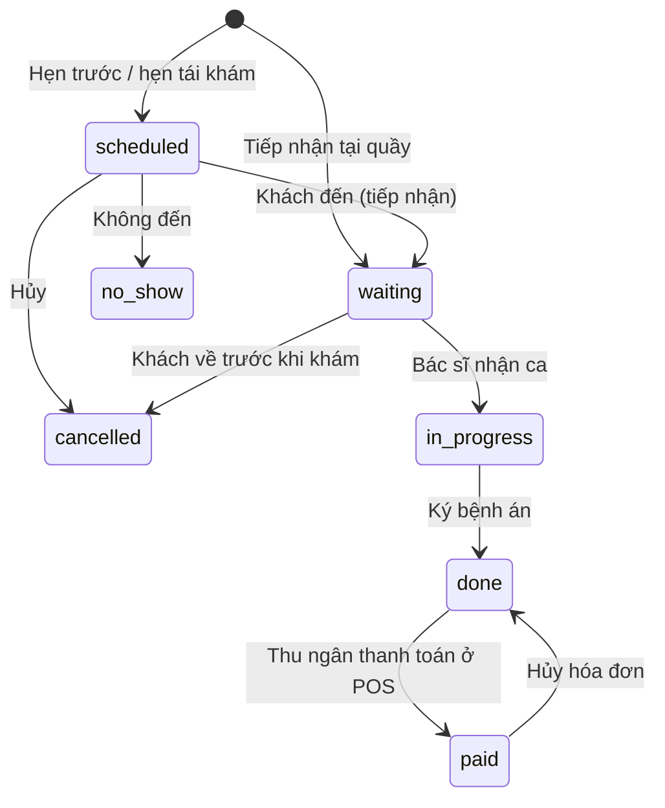

# Hồ sơ bệnh án (Y tế)

Kế hoạch module Y tế: tiếp nhận khám, hàng chờ, bệnh án SOAP có ký khóa, chẩn đoán, chỉ định dịch vụ và đơn thuốc trừ kho theo lô, sổ tiêm và danh sách nhắc tiêm, thanh toán qua POS, báo cáo, khách xem sổ tiêm và lịch sử khám, nội trú điều trị dùng chung chuồng lưu trú. Nguồn: kế hoạch BA/kiến trúc v0.3 (mục 1.2 A–E, edge case 10–16, module M4, M5, M8; Y tế là **Phase 2**). Module đứng sau RBAC theo (nhân viên, cơ sở) (PR #42), POS (PR #43), kho theo lô FEFO (`docs/kho-theo-lo-han-dung.md`), lịch hẹn spa (`docs/lich-hen-spa.md`) và khách sạn thú cưng (`docs/khach-san-thu-cung.md`), đều đã merge.

**Tiến độ:** bước 1 xong (quyền và vai trò bác sĩ, nhóm dịch vụ, danh mục chẩn đoán và vắc-xin, quy định, màn Cài đặt y tế). Bước 2 xong (lượt khám, hàng chờ, tiếp nhận và hẹn trước, danh sách lượt khám, trang khám với tab Bệnh án, ký và bổ sung, tab Bệnh án ở chi tiết thú). Bước 3 xong (dòng chỉ định và thuốc, tính giá, cảnh báo tồn, đơn thuốc in được, tab Chỉ định & thuốc; lượt khám không có gì để tính thì ký xong là đã thanh toán). Bước 4 xong (sổ tiêm điện tử, ghi mũi tiêm tại phòng khám kèm dòng tính tiền theo lô, mũi ngoại viện, hủy mũi, tab Tiêm phòng ở trang khám, tab Sổ tiêm ở chi tiết thú, màn Nhắc lịch). Bước 5 xong (khoản khám và thuốc của phiếu đã ký thu tiền ở POS qua hộp "Khám bệnh chờ thanh toán", trừ kho theo lô bác sĩ chọn trước rồi mới theo hạn dùng, hủy hóa đơn trả khoản về chờ thu, tab Tiền ở trang khám). Bước 6 xong (báo cáo doanh thu có thêm mảng Y tế: thẻ cơ cấu, cột và biểu đồ ngày; thuốc của phiếu khám vẫn tính vào lãi gộp qua giá vốn). Bước 7 xong: đã có trang Sổ sức khỏe phía khách (sổ tiêm và lịch sử khám, không SOAP, không giá) và dòng mũi tiêm tiếp theo ở thẻ thú; cờ cảnh báo bệnh truyền nhiễm, mũi quá hạn và dị ứng ở check-in spa và lưu trú; nhóm sản phẩm "Chỉ bán tại phòng khám" (ẩn khỏi danh sách shop, giỏ và đặt hàng; công tắc ở form sản phẩm, lưu ngay). Đính kèm (xét nghiệm, X-quang, ảnh, giấy cam kết; ảnh hoặc PDF tối đa 10 MB, bucket riêng tư, link ký 10 phút) ở tab Đính kèm của trang khám và ô "Khám hôm nay" trên dashboard. Bước 7 xong. Bước 8 chưa làm. Thứ tự làm ở mục 10.

Dự án là pet project cá nhân, chưa có doanh thu, nên phạm vi giữ ở mức một phòng khám nhỏ dùng được hằng ngày: một bác sĩ hoặc vài bác sĩ, một cơ sở, thiết kế sẵn cho nhiều cơ sở, không tích hợp bên ngoài (không Zalo/SMS, không HĐĐT), không tạm ứng.

## 1. Trước và sau

**Trước:** hệ thống không có phần khám chữa bệnh. Trang chi tiết thú có tab "Bệnh án" bị tắt. Tiền khám và thuốc phải gõ tay trong POS như hàng lẻ, không biết thuốc bán cho thú nào, không có sổ tiêm, lưu trú chỉ có ô tích "đã xem sổ tiêm".

**Sau:** lễ tân tiếp nhận thú (khách có sẵn hoặc vãng lai), ghi lý do khám, mức ưu tiên, cân nặng, nhiệt độ; thú vào **hàng chờ khám** của ngày. Bác sĩ nhận ca, xem lịch sử khám, sổ tiêm, dị ứng, ghi chú hành vi; ghi bệnh án theo **SOAP**, thêm chẩn đoán, chỉ định dịch vụ (xét nghiệm, siêu âm, thủ thuật), dùng thuốc tại chỗ và kê **đơn thuốc mang về** (thuốc trong kho hoặc thuốc mua ngoài), tiêm vắc-xin (ghi vào **sổ tiêm**, hệ thống tự tính ngày nhắc mũi sau), hẹn tái khám. Bác sĩ **ký** bệnh án: nội dung khóa, sau đó chỉ được **bổ sung** có ghi người và giờ. Thu ngân mở POS, kéo "Khám bệnh chờ thanh toán" của khách vào giỏ chung cùng hàng shop, phiếu spa, lưu trú; thuốc và vắc-xin trừ kho theo lô (vắc-xin trừ đúng lô đã tiêm). Danh sách **nhắc tiêm / tái khám** cho lễ tân gọi điện. Khách xem sổ tiêm và lịch sử khám của thú mình trên trang tài khoản. Báo cáo doanh thu có thêm mảng **Y tế**.

## 2. Phạm vi

| Mức | Nội dung |
| --- | --- |
| **Must** | Quyền `medical`; danh mục dịch vụ có nhóm (spa / y tế / khác); danh mục chẩn đoán; danh mục vắc-xin và tẩy giun kèm phác đồ đơn giản; tiếp nhận khám và hàng chờ theo ngày; lượt khám có sinh hiệu, SOAP, chẩn đoán, kết luận; ký khóa và bổ sung; chỉ định dịch vụ, thuốc dùng tại chỗ, đơn thuốc mang về, thuốc mua ngoài; giá do database tính; sổ tiêm (tại phòng khám và ngoại viện), tự tính ngày nhắc; danh sách nhắc tiêm và tái khám; hẹn tái khám thành lượt khám đã hẹn; thanh toán qua POS, trừ kho FEFO và đúng lô vắc-xin; hủy hóa đơn trả khoản về chưa thanh toán; danh sách lượt khám có tìm kiếm, lọc, phân trang, xuất file; tab Bệnh án và Sổ tiêm ở trang chi tiết thú; mảng Y tế trong báo cáo |
| **Should** | In đơn thuốc và giấy chứng nhận tiêm phòng (trang in, không PDF server); file đính kèm (kết quả xét nghiệm, X-quang, ảnh, giấy cam kết) trong bucket riêng tư; khách xem sổ tiêm và lịch sử khám; cảnh báo bệnh truyền nhiễm và sổ tiêm ở check-in lưu trú và spa; ẩn thuốc khỏi shop online; nội trú điều trị dùng chung chuồng và lượt lưu trú, có bảng y lệnh; ô "Khám hôm nay" trên dashboard |
| **Could** | Tính liều theo mg/kg; hoạt chất thuốc để cảnh báo dị ứng tự động; mẫu SOAP theo bệnh hay gặp; kéo thả hàng chờ; biểu đồ cân nặng trong trang khám; khách đặt lịch khám trên web |
| **Won't (lần này)** | Tạm ứng nội trú và công nợ; sổ thuốc kiểm soát (gây mê, opioid); lọ thuốc đa liều đã mở; nhắc qua Zalo/SMS/email; kết nối máy xét nghiệm; chuyển tuyến điện tử; chữ ký số; hoa hồng bác sĩ |

## 3. Luồng nghiệp vụ



1. **Tiếp nhận:** lễ tân tìm khách theo SĐT / tên (dùng lại `search_customers`), chọn thú của khách; khách hay thú mới thì thêm ở màn Thú cưng trước (nhân viên thêm thú, theo quyết định ngày 2026-10-15). Ghi lý do khám, ưu tiên (thường / cấp cứu), bác sĩ chỉ định (hoặc để trống = ai rảnh nhận), cân nặng (ghi vào `pet_weight_logs`), nhiệt độ. Lượt vào hàng chờ với số thứ tự trong ngày. Lượt đã hẹn (`scheduled`) thì bấm "Khách đã đến" để tiếp nhận.
2. **Hàng chờ:** màn hàng chờ chia cột Chờ khám / Đang khám / Xong chờ thanh toán. Ca cấp cứu lên đầu, sau đó theo giờ tiếp nhận. Nhãn đỏ khi thú có dị ứng, ghi chú hành vi hoặc chẩn đoán truyền nhiễm gần đây.
3. **Khám:** bác sĩ bấm "Nhận ca" (`in_progress`, gán mình làm bác sĩ). Trang khám có bên trái là hồ sơ thú (dị ứng, hành vi, cân nặng gần đây, sổ tiêm, các lượt khám trước), bên phải là bệnh án: sinh hiệu, S (bệnh sử, lời khách kể), O (khám lâm sàng), A (chẩn đoán, nhiều dòng), P (hướng điều trị), lời dặn cho chủ, kết luận (về nhà / hẹn tái khám / nhập viện / chuyển tuyến / đã mất), ngày tái khám. Bệnh án tự lưu nháp.
4. **Chỉ định và đơn thuốc:** trong cùng trang, tab "Chỉ định & thuốc": thêm dịch vụ y tế (khám tổng quát, xét nghiệm máu, siêu âm…), thuốc / vật tư dùng tại chỗ, thuốc mang về (liều, số lần / ngày, số ngày, cách dùng), thuốc mua ngoài (chỉ ghi, không tính tiền). Vắc-xin thêm từ tab "Tiêm phòng": chọn loại vắc-xin, lô còn hạn (gợi ý lô hết hạn sớm nhất), hệ thống tạo đồng thời một dòng thuốc tính tiền và một dòng sổ tiêm với ngày nhắc.
5. **Ký:** bấm "Hoàn tất & ký". Kiểm: có ít nhất một chẩn đoán hoặc phần A không trống; kết luận đã chọn; hẹn tái khám thì có ngày. Lượt chuyển `done`, nội dung SOAP và chẩn đoán khóa. Hẹn tái khám tạo một lượt `scheduled` mới nối với lượt này. Muốn sửa thì viết **bổ sung**.
6. **Thanh toán:** trong POS, chọn khách thì hiện "Khám bệnh chờ thanh toán (n)" cạnh phiếu spa và lưu trú. Dịch vụ vào hóa đơn với giá đã chốt, thuốc vào hóa đơn như dòng sản phẩm (trừ kho FEFO; dòng vắc-xin trừ đúng lô đã ghi). Mọi khoản tính tiền của lượt đã vào hóa đơn thì lượt `paid`; hủy hóa đơn thì về `done`.
7. **Nhắc tiêm, tái khám:** màn "Nhắc lịch" liệt kê mũi tiêm sắp đến hạn / quá hạn và lượt tái khám đã hẹn, để lễ tân gọi điện và đánh dấu "đã gọi". Thú đã mất không hiện.
8. **Nội trú (Should):** kết luận "nhập viện" mở dialog đặt chuồng y tế / cách ly (dùng lại lượt lưu trú với `kind = 'inpatient'`), bác sĩ lập y lệnh, trợ lý tích khi cho thuốc; thuốc đã cho thành dòng tính tiền của lượt khám; tiền chuồng tính như lưu trú khi xuất viện.

## 4. Mô hình dữ liệu

Bảng theo cơ sở có `branch_id not null`. Thời gian `timestamptz`; ngày nghiệp vụ theo `public.business_date()`. Mã chứng từ `CS01-KB-000123` sinh bằng `next_doc_code(branch, 'KB')`. **Hồ sơ gắn với thú, không gắn với chủ** (BA mục D): lượt khám có `customer_id` là người đưa đến và trả tiền, nhưng lịch sử theo `pet_id` nên đổi chủ vẫn giữ.

| Bảng | Vai trò |
| --- | --- |
| `pet_services.category` (cột mới) | Nhóm dịch vụ `spa`, `medical`, `other`. Dịch vụ y tế (khám, xét nghiệm, thủ thuật) nằm chung danh mục dịch vụ, có giá theo cân như spa |
| `product_groups.clinic_only` (cột mới, Should) | Thuốc chỉ bán qua phòng khám: ẩn khỏi shop online |
| `invoice_lines.lot_id` (cột mới) | Lô ưu tiên khi trừ kho; chỉ dòng vắc-xin có |
| `pets.deceased_on` (cột mới) | Ngày mất, khi `status = 'deceased'` |
| `medical_settings` | Quy định y tế theo cơ sở |
| `diagnosis_terms` | Danh mục chẩn đoán dùng chung |
| `vaccine_types` | Danh mục vắc-xin / tẩy giun / phòng ngừa, kèm phác đồ đơn giản |
| `medical_visits` | Một lượt khám của một thú tại một cơ sở: tiếp nhận, sinh hiệu, SOAP, kết luận, ký |
| `medical_diagnoses` | Các chẩn đoán của lượt |
| `medical_visit_items` | Chỉ định dịch vụ, thuốc dùng tại chỗ, thuốc mang về, thuốc mua ngoài. Gắn hóa đơn qua `invoice_line_id` |
| `medical_addenda` | Bổ sung sau khi ký |
| `vaccinations` | Sổ tiêm: một mũi tiêm / tẩy giun của một thú |
| `medical_attachments` (Should) | File đính kèm trong bucket riêng tư `medical` |
| `inpatient_orders`, `inpatient_doses` (Should) | Y lệnh nội trú và lần thực hiện |

### `pet_services.category`

`text not null default 'spa' check (category in ('spa', 'medical', 'other'))`. Dữ liệu cũ thành `spa`. Màn Dịch vụ thêm cột và bộ lọc nhóm. Các chỗ liệt kê dịch vụ cho **spa** (dialog đặt lịch spa, `spa_public_catalog`, `spa_web_slots`) lọc `category = 'spa'`; trang khám lọc `category = 'medical'`; POS và phát sinh lưu trú vẫn thấy mọi nhóm. Giá dùng lại `get_service_price` (theo loài, cân, cơ sở) nên dịch vụ y tế có thể tính theo cân (gây mê, triệt sản) hoặc giá chung (khám tổng quát).

### `medical_settings` (một dòng mỗi cơ sở; thiếu dòng thì dùng mặc định)

| Cột | Mặc định | Ghi chú |
| --- | --- | --- |
| `exam_service_id` | null | Dịch vụ tự thêm khi bác sĩ nhận ca (ví dụ "Khám tổng quát"); null = không tự thêm |
| `remind_ahead_days` | 7 | Màn nhắc lịch hiện mũi tiêm đến hạn trong bấy nhiêu ngày tới |
| `contagious_days` | 30 | Chẩn đoán truyền nhiễm trong bấy nhiêu ngày gần đây thì cảnh báo ở spa / lưu trú |
| `require_vaccine_for_boarding` | false | Should: true thì check-in lưu trú cảnh báo đỏ khi sổ tiêm điện tử thiếu mũi còn hạn (vẫn không chặn) |

### `diagnosis_terms`

`name` (duy nhất, không phân biệt hoa thường), `species_ids uuid[]` (rỗng = mọi loài), `is_contagious` (Parvo, Care, nấm…), `is_active`, `sort_order`. Bác sĩ chọn từ danh mục hoặc gõ tự do; gõ tự do không tự thêm vào danh mục.

### `vaccine_types`

| Cột | Ghi chú |
| --- | --- |
| `name` | Ví dụ "Vắc-xin 7 bệnh chó", "Dại", "Tẩy giun", "Nhỏ gáy phòng ve" |
| `kind` | `vaccine`, `deworm`, `other` |
| `species_ids uuid[]` | Loài áp dụng; rỗng = mọi loài |
| `product_id` | Sản phẩm trong kho dùng để tiêm (tính tiền và trừ kho). Null = chỉ ghi sổ (ví dụ chỉ nhập ngoại viện) |
| `series_doses` | Số mũi cơ bản (mặc định 1) |
| `series_interval_days` | Khoảng cách giữa các mũi cơ bản (ví dụ 21) |
| `booster_interval_days` | Nhắc lại sau mũi cơ bản cuối (ví dụ 365); null = không nhắc |
| `min_age_weeks` | Tuổi tối thiểu; nhỏ hơn thì cảnh báo, không chặn |
| `is_active`, `sort_order` | |

Đây là "phác đồ" ở mức đơn giản: không cần bảng bước riêng. Mũi thứ n < `series_doses` thì ngày nhắc = ngày tiêm + `series_interval_days`; mũi cuối của chuỗi và các mũi nhắc thì + `booster_interval_days`. Ngày nhắc bác sĩ sửa được.

### `medical_visits`

| Cột | Ghi chú |
| --- | --- |
| `code`, `branch_id`, `pet_id`, `customer_id` | Khách bắt buộc (hóa đơn theo chủ); thú phải thuộc khách (`pet_owners` còn hiệu lực) |
| `pet_name`, `customer_name`, `customer_phone` | Bản sao để danh sách đọc nhanh |
| `status` | `scheduled`, `waiting`, `in_progress`, `done`, `paid`, `cancelled`, `no_show` |
| `priority` | `normal`, `urgent` |
| `queue_date`, `queue_no` | Ngày nghiệp vụ và số thứ tự khi tiếp nhận; `unique (branch_id, queue_date, queue_no)` |
| `scheduled_at` | Giờ hẹn (lượt `scheduled`) |
| `reason` | Lý do khám |
| `vet_id` | Bác sĩ (`public.users`); null khi chưa ai nhận |
| `vet_name` | Bản sao |
| `checked_in_at`, `started_at` | |
| `weight_kg`, `temperature_c`, `heart_rate`, `resp_rate`, `vitals_note` | Sinh hiệu. Cân lưu theo lượt (BA case 12) và cũng ghi `pet_weight_logs` |
| `subjective`, `objective`, `assessment`, `plan` | SOAP, chữ tự do |
| `owner_instructions` | Lời dặn cho chủ: phần khách đọc được |
| `outcome` | `home`, `recheck`, `inpatient`, `referred`, `deceased` |
| `recheck_on` | Ngày tái khám (khi `outcome = 'recheck'`) |
| `follow_up_of` | Lượt gốc khi đây là lượt tái khám |
| `signed_at`, `signed_by`, `signed_by_name` | Ký khóa |
| `source` | `counter`, `phone`, `recheck`; `web` để dành |
| `cancelled_at`, `cancel_reason`, `created_by`, `created_at`, `updated_at` | |

Trigger `medical_visits_lock`: khi `signed_at` đã có thì không cho đổi các cột sinh hiệu, SOAP, `owner_instructions`, `outcome`, `recheck_on`, `pet_id`, `customer_id` (chỉ RPC thanh toán đổi `status`). Khóa nằm ở database nên không vòng qua được bằng client.

### `medical_diagnoses`

`visit_id`, `term_id` (null = gõ tự do), `name` (chép từ danh mục hoặc chữ tự do), `is_contagious` (chép từ danh mục, bác sĩ tích được với chữ tự do), `note`, `sort_order`. Khóa theo lượt đã ký (trigger chặn thêm / sửa / xóa).

### `medical_visit_items`

| Cột | Ghi chú |
| --- | --- |
| `visit_id`, `branch_id` | |
| `kind` | `service` (dịch vụ y tế), `product` (thuốc / vật tư trong kho), `external` (thuốc mua ngoài, không tính tiền) |
| `service_id` / `product_id`, `unit_id`, `unit_factor` | Đơn vị quy đổi như POS (`product_units`) |
| `name`, `qty`, `unit_price`, `amount` | Tên và giá do database tính (`get_service_price` với cân của lượt; `product_unit_price` với cơ sở và đơn vị). `external`: giá 0 |
| `take_home` | Thuốc mang về (in vào đơn thuốc). `false` = dùng tại chỗ |
| `dose`, `frequency`, `days`, `route`, `instructions` | Chữ tự do cho đơn thuốc: "1/2 viên", "2 lần / ngày", 5 ngày, "uống", "sau ăn" |
| `lot_id` | Lô cụ thể, chỉ dòng vắc-xin |
| `vaccination_id` | Dòng sổ tiêm tạo cùng |
| `invoice_line_id` | Gắn khi vào hóa đơn; null lại khi hủy hóa đơn |
| `created_by`, `created_at` | |

`check`: `service` có `service_id`, `product` có `product_id`, `external` không có cả hai và có `name`.

### `medical_addenda`

`visit_id`, `content` (không rỗng), `created_by`, `created_by_name`, `created_at`. Chỉ thêm, không sửa, không xóa.

### `vaccinations`

| Cột | Ghi chú |
| --- | --- |
| `pet_id`, `vaccine_type_id`, `branch_id` (null với ngoại viện) | |
| `dose_no` | Mũi thứ mấy trong chuỗi; RPC gợi ý = số mũi đã có của loại này + 1 |
| `given_on` | Ngày tiêm |
| `visit_id`, `visit_item_id` | Null với ngoại viện |
| `lot_id`, `lot_no`, `expiry_date` | Lô trong kho (tại phòng khám) hoặc chữ tự do (ngoại viện), để truy vết khi thu hồi lô |
| `is_external`, `external_place` | Tiêm nơi khác (BA case 14): không trừ kho, không tính tiền |
| `vet_name` | Người tiêm |
| `next_due_on` | Ngày nhắc mũi sau; null = không nhắc |
| `reminded_at`, `reminded_by`, `remind_note` | Lễ tân đã gọi nhắc |
| `voided_at`, `void_reason` | Ghi nhầm thì hủy dòng, không xóa |
| `created_by`, `created_at` | |

Mũi mới của cùng thú và cùng loại làm mũi cũ hết cần nhắc (màn nhắc lịch chỉ lấy mũi mới nhất còn hiệu lực của mỗi cặp thú × loại).

### `medical_attachments` (Should)

`visit_id`, `pet_id`, `kind` (`lab`, `imaging`, `photo`, `consent`, `other`), `title`, `file_path` (trong bucket riêng tư `medical`, đường dẫn `pet_id/visit_id/uuid.ext`), `mime_type`, `size_bytes`, `created_by`, `created_at`. Bucket không public; đọc bằng signed URL 10 phút. Policy `storage.objects` theo `can_medical('VIEW')`. Giới hạn 10 MB mỗi file, ảnh và PDF.

### Hóa đơn và kho

- Không thêm `item_type` mới. Dòng dịch vụ y tế vào hóa đơn là `service`, thuốc là `product`, nên trigger `invoice_line_take_stock` trừ kho như POS. Báo cáo nhận ra dòng y tế nhờ `medical_visit_items.invoice_line_id`.
- Cột mới `invoice_lines.lot_id`: khi có, hàm trừ kho lấy lô đó trước (còn hạn và đủ hàng), thiếu thì lấy tiếp FEFO. Hàm mới `take_stock_lot_first(...)` và bản mới của `invoice_line_take_stock()` chép từ bản mới nhất (`20261015040400_invoice_line_units_stock.sql`). Dòng không có `lot_id` chạy y như cũ.
- Hủy hóa đơn và trả hàng không đổi: hoàn kho theo `stock_movements` đã ghi, vốn đã theo từng lô.

### Nội trú (Should)

Dùng lại lượt lưu trú: thêm `boarding_stays.kind` (`boarding` mặc định, `inpatient`) và `boarding_stays.visit_id`. Lượt nội trú chỉ xếp vào loại chuồng `purpose` là `medical` hoặc `isolation` (cột đã có); thú có chẩn đoán truyền nhiễm thì bắt buộc `isolation` (BA case 16). Tiền chuồng, check-out, thanh toán đi đúng luồng lưu trú. Thêm:

- `inpatient_orders`: `stay_pet_id`, `visit_id`, `kind` (`product`, `service`, `care`), `product_id` / `service_id`, `name`, `dose`, `qty_per_dose`, `times text[]` (giờ trong ngày, ví dụ `{08:00,20:00}`), `start_on`, `end_on`, `note`, `stopped_at`, `created_by`.
- `inpatient_doses`: `order_id`, `due_at`, `given_at`, `given_by`, `skipped_reason`. Tích "đã cho" với y lệnh `product` / `service` thì cộng `qty_per_dose` vào một dòng `medical_visit_items` của lượt khám nhập viện (tính tiền và trừ kho khi thanh toán).
- Sinh hiệu theo ca ghi bằng nhật ký chăm sóc sẵn có (`boarding_care_logs`) với `kind` mới `vitals` và `treatment`.
- Lượt khám nhập viện ở trạng thái `in_progress` đến khi xuất viện; bác sĩ ký khi xuất viện.

## 5. Quy tắc nghiệp vụ

1. **Hồ sơ theo thú.** Nhân viên có `medical: VIEW` ở bất kỳ cơ sở nào xem được toàn bộ lịch sử của thú (danh mục thú và khách dùng chung mọi cơ sở). Ghi chỉ ở cơ sở có quyền.
2. **Thú phải thuộc khách** khi tiếp nhận (`pet_owners.to_date is null`); không thì lỗi `no_pet`. Thú `deceased` không tiếp nhận được (`pet_deceased`); thú `archived` thì cảnh báo.
3. **Một thú một lượt mở**: không có hai lượt `waiting` / `in_progress` cùng lúc của một thú (unique index một phần). Lỗi `pet_busy`.
4. **Số thứ tự** tăng theo (cơ sở, ngày), cấp trong RPC với khóa `pg_advisory_xact_lock`. Hàng chờ xếp `urgent` trước, rồi `checked_in_at`.
5. **Nhận ca**: chỉ lượt `waiting`; người nhận cần `medical: UPDATE` ở cơ sở; gán `vet_id` là mình nếu đang trống. Nếu cài `exam_service_id` thì tự thêm dòng dịch vụ đó.
6. **Bệnh án nháp** lưu bằng `save_medical_record` (gửi cả khối, debounce 1,5 giây ở UI, nút "Lưu" vẫn có). Chỉ người có `medical: UPDATE`; lượt phải `in_progress`.
7. **Ký** chỉ lượt `in_progress`, người ký có `medical: UPDATE`. Cần: `outcome`; có ít nhất một chẩn đoán hoặc `assessment` không trống; `recheck` thì cần `recheck_on` ≥ hôm nay; `inpatient` thì cần lượt nội trú đã tạo (Should, trước khi có thì chặn lựa chọn này). Ký xong: `signed_*`, `status = 'done'`; `recheck` tạo lượt `scheduled` (`source = 'recheck'`, `follow_up_of`, `scheduled_at` = 09:00 ngày tái khám, cùng bác sĩ); `deceased` đặt `pets.status = 'deceased'`, `deceased_on` = hôm nay, và mọi nhắc của thú tự tắt (BA case 10). Lượt không có dòng tính tiền nào thì ký xong là `paid` luôn.
8. **Sau khi ký**: SOAP, sinh hiệu, chẩn đoán khóa (trigger). Bổ sung thì thêm `medical_addenda`. **Dòng tính tiền vẫn thêm / bỏ được** khi chưa vào hóa đơn (quên tính một mũi tiêm không phải sửa bệnh án), mỗi dòng có người và giờ tạo. Dòng đã vào hóa đơn không bỏ được.
9. **Giá chốt lúc thêm dòng**: dịch vụ theo `get_service_price(loài, dịch vụ, cân của lượt, cơ sở)`; thuốc theo `product_unit_price(sản phẩm, cơ sở, đơn vị)`. Client không gửi giá. Chưa có cân mà dịch vụ tính theo cân thì lỗi `no_weight`.
10. **Kho**: thêm dòng thuốc chỉ **cảnh báo** khi tồn khả dụng tại cơ sở không đủ (`low_stock`), không giữ hàng. Trừ kho thật lúc thanh toán; thiếu lúc đó thì POS báo `out_of_stock` như bán hàng.
11. **Vắc-xin**: chọn lô còn hạn, còn hàng tại cơ sở; mặc định lô hết hạn sớm nhất (FEFO). Thú nhỏ hơn `min_age_weeks` hoặc loài không hợp thì cảnh báo vàng. Tạo một dòng `product` có `lot_id` (nếu loại có `product_id`) và một dòng `vaccinations`. Bỏ dòng tính tiền thì hủy luôn dòng sổ tiêm (`voided_at`).
12. **Tiêm ngoại viện**: nhập ở tab Sổ tiêm của thú, không cần lượt khám, quyền `medical: CREATE`.
13. **Dị ứng** (`pets.allergies`) hiện băng đỏ trên trang khám và trong dialog thêm thuốc; thú có dị ứng thì dialog thêm thuốc bắt tích "Đã kiểm tra dị ứng" (BA case 13 ở mức không có dữ liệu hoạt chất).
14. **Hủy lượt**: chỉ `scheduled` / `waiting`, hoặc `in_progress` chưa có dòng nào và chưa ký. **Không đến**: `scheduled` đã qua ngày hẹn.
15. **Thanh toán qua POS**: chỉ dòng `service` / `product` chưa có `invoice_line_id` của lượt `done` (hoặc lượt nội trú khi xuất viện), cùng cơ sở, cùng khách của hóa đơn. Hết dòng chờ thì lượt `paid`; hủy hóa đơn thì về `done`.
16. **Nhắc lịch**: mũi mới nhất còn hiệu lực của mỗi (thú, loại) có `next_due_on` ≤ hôm nay + `remind_ahead_days`, thú `active`, chủ còn liên hệ; cộng các lượt `scheduled` trong khoảng đó. Đánh dấu "đã gọi" chỉ ghi `reminded_at`, không đổi ngày.
17. **Cảnh báo chéo (Should)**: `pet_health_flags(p_pet_ids)` (security definer, trả cờ chứ không trả bệnh án) cho spa và lưu trú: `contagious` (chẩn đoán truyền nhiễm trong `contagious_days`), `vaccine_overdue` (có mũi quá hạn), `allergies`. Người không có `medical: VIEW` vẫn thấy cờ, không thấy chi tiết.

## 6. RPC

Theo quy ước repo: nghiệp vụ nhiều bước trong Postgres function `security definer`, client chỉ đọc bảng qua RLS. Lỗi có `hint` để UI dịch. Danh sách có tìm kiếm + trang + cỡ trang. Cột **Bước** là bước ở mục 10.

| RPC | Bước | Việc làm |
| --- | --- | --- |
| `can_medical(p_method, p_branch)` | 1 | `is_admin()` hoặc `has_permission('medical', method, branch)` |
| `save_diagnosis_term(p jsonb, p_id uuid default null)`, `list_diagnosis_terms(p_search, p_species, p_page, p_page_size)` | 1 | Danh mục chẩn đoán |
| `save_vaccine_type(p jsonb, p_id uuid default null)`, `list_vaccine_types(p_search, p_kind, p_page, p_page_size)` | 1 | Danh mục vắc-xin / tẩy giun kèm tên sản phẩm và tồn tại cơ sở |
| `medical_settings_get(p_branch)`, `save_medical_settings(p_branch, p)` | 1 | Quy định y tế |
| `save_pet_service` (sửa) | 1 | Nhận thêm `category`; màn Dịch vụ đọc bảng `pet_services` trực tiếp nên chỉ thêm cột và bộ lọc ở `src/repositories/petServices.ts` |
| `check_in_medical_visit(p jsonb)` | 2 | Tiếp nhận: khách, thú, lý do, ưu tiên, bác sĩ, cân, nhiệt độ; cấp số thứ tự; ghi cân. Nhận `visit_id` của lượt `scheduled` để chuyển `waiting`. Lỗi: `no_customer`, `no_pet`, `pet_deceased`, `pet_busy` |
| `schedule_medical_visit(p jsonb, p_id uuid default null)` | 2 | Tạo / sửa lượt hẹn trước (`scheduled`) |
| `start_medical_visit(p_id)` | 2 | Nhận ca, gán bác sĩ, tự thêm dịch vụ khám |
| `assign_medical_vet(p_id, p_vet)` | 2 | Đổi bác sĩ khi chưa ký |
| `save_medical_record(p_id, p jsonb)` | 2 | Lưu sinh hiệu, SOAP, lời dặn, kết luận, ngày tái khám, danh sách chẩn đoán (thay cả danh sách). Lỗi `signed` nếu đã ký |
| `sign_medical_visit(p_id)` | 2 | Kiểm theo quy tắc 7, ký, tạo lượt tái khám, đặt thú đã mất. Lỗi: `no_outcome`, `no_assessment`, `bad_recheck`, `not_in_progress` |
| `add_medical_addendum(p_id, p_content)` | 2 | Bổ sung sau ký |
| `cancel_medical_visit(p_id, p_reason)`, `mark_medical_no_show(p_id)` | 2 | Quy tắc 14 |
| `medical_queue(p_branch, p_date)` | 2 | Hàng chờ ngày: lượt `scheduled` của ngày, `waiting`, `in_progress`, `done` chưa thanh toán; kèm cờ dị ứng / hành vi / truyền nhiễm |
| `list_medical_visits(p_branch, p_from, p_to, p_status, p_vet, p_search, p_page, p_page_size)` | 2 | Bảng danh sách: tìm theo mã, tên khách (không dấu), SĐT, tên thú, chẩn đoán; trả `{ rows, total }` |
| `get_medical_visit(p_id)` | 2 | Một lượt đầy đủ: thú, chủ, sinh hiệu, SOAP, chẩn đoán, dòng, bổ sung, tiêm, đính kèm, hóa đơn |
| `pet_medical_history(p_pet, p_page, p_page_size)` | 2 | Các lượt của thú (mới nhất trước) cho tab Bệnh án và cột trái trang khám |
| `add_medical_item(p_visit, p jsonb)` | 3 | Thêm dịch vụ / thuốc / thuốc ngoài; tính giá; cảnh báo tồn (`warnings: ['low_stock']` trong kết quả, không lỗi). Lỗi: `no_weight`, `not_available`, `paid` |
| `update_medical_item(p_id, p jsonb)` | 3 | Sửa số lượng, đơn vị, liều, cách dùng khi chưa vào hóa đơn; tính lại giá |
| `remove_medical_item(p_id)` | 3 | Bỏ dòng chưa vào hóa đơn (hủy luôn dòng sổ tiêm đi kèm) |
| `medical_prescription(p_visit)` | 3 | Dữ liệu trang in đơn thuốc: thú, chủ, chẩn đoán, dòng `take_home` và `external`, lời dặn, ngày tái khám, bác sĩ |
| `vaccine_lots(p_branch, p_vaccine_type)` | 4 | Lô còn hạn, còn hàng của sản phẩm gắn loại vắc-xin, FEFO |
| `give_vaccination(p_visit, p jsonb)` | 4 | `{ vaccine_type_id, lot_id?, dose_no?, next_due_on? }`: tạo dòng tính tiền (nếu có sản phẩm) + dòng sổ tiêm, tính `next_due_on` |
| `add_external_vaccination(p_pet, p jsonb)` | 4 | Mũi ngoại viện |
| `void_vaccination(p_id, p_reason)` | 4 | Hủy dòng sổ tiêm ghi nhầm (dòng ngoại viện, hoặc dòng tại phòng khám chưa vào hóa đơn) |
| `pet_vaccinations(p_pet)` | 4 | Sổ tiêm của thú, nhóm theo loại, kèm trạng thái còn hạn / sắp đến hạn / quá hạn |
| `medical_reminders(p_branch, p_scope, p_search, p_page, p_page_size)` | 4 | `p_scope`: `due` (sắp đến hạn), `overdue`, `recheck`. Kèm SĐT chủ chính |
| `mark_reminded(p_vaccination, p_note)` | 4 | Đánh dấu đã gọi |
| `billable_medical_items(p_branch, p_customer)` | 5 | Lượt `done` có dòng chưa thanh toán của khách, nhóm theo lượt, cho POS |
| `create_invoice` / `cancel_invoice` (sửa) | 5 | Nhận dòng `{ type: 'medical_item', id }`: đọc loại, giá, số lượng, đơn vị, lô từ dòng khám; kiểm khách, cơ sở, trạng thái; ghi `invoice_lines` (`service` hoặc `product`, `lot_id`) và `invoice_line_id`; làm mới trạng thái lượt. Hủy hóa đơn gỡ liên kết. **Chép từ bản mới nhất** (`20261020040100_boarding_invoice_rpcs.sql`) rồi cộng phần y tế |
| `take_stock_lot_first(...)`, `invoice_line_take_stock()` (sửa) | 5 | Trừ đúng lô vắc-xin trước, rồi FEFO |
| `report_sales_lines` (sửa) và các hàm tổng quan | 6 | Mảng `medical` cho dòng có trong `medical_visit_items`; tổng quan trả thêm `segments.medical` |
| `my_pet_health(p_pet)` | 7 (Should) | Khách đang đăng nhập là chủ hiện tại của thú: sổ tiêm và các lượt đã ký (ngày, lý do, chẩn đoán, lời dặn, thuốc mang về, ngày tái khám). Không trả SOAP |
| `pet_health_flags(p_pet_ids uuid[])` | 7 (Should) | Cờ cho spa và lưu trú (quy tắc 17) |
| `add_medical_attachment(p_visit, p jsonb)`, `delete_medical_attachment(p_id)` | 7 (Should) | Ghi metadata sau khi client tải file lên bucket `medical` |
| `admit_inpatient(p_visit, p jsonb)` | 8 (Should) | Tạo lượt lưu trú `inpatient` cho thú của lượt khám vào chuồng y tế / cách ly; dùng lại kiểm tra của `save_boarding_stay` |
| `save_inpatient_order(p jsonb, p_id uuid default null)`, `stop_inpatient_order(p_id)` | 8 (Should) | Y lệnh |
| `inpatient_ward(p_branch, p_date)` | 8 (Should) | Bảng y lệnh theo giờ trong ngày của mọi thú đang nội trú |
| `give_inpatient_dose(p_dose)`, `skip_inpatient_dose(p_dose, p_reason)` | 8 (Should) | Tích thực hiện; cộng vào dòng tính tiền của lượt khám |
| `discharge_inpatient(p_stay)` | 8 (Should) | Xuất viện: check-out lượt lưu trú (tiền chuồng) và chuyển lượt khám sang chờ ký |

## 7. Phân quyền

Thêm quyền `medical` (module "Y tế") với `VIEW`, `CREATE`, `UPDATE`, `DELETE`, `SETTING`, `EXPORT`, `ALL` (bộ method có sẵn, không thêm method mới); kiểm theo cơ sở bằng `has_permission('medical', method, branch)`, bọc trong `can_medical(method, branch)`.

| Việc | Quyền |
| --- | --- |
| Xem hàng chờ, danh sách, bệnh án, sổ tiêm, nhắc lịch | `medical: VIEW` |
| Tiếp nhận, hẹn trước, đo cân / nhiệt độ, nhập mũi tiêm ngoại viện, đánh dấu đã gọi, tích y lệnh (Should) | `medical: CREATE` |
| Nhận ca, ghi bệnh án, chẩn đoán, chỉ định, kê đơn, tiêm, ký, bổ sung, lập y lệnh | `medical: UPDATE` (bác sĩ) |
| Hủy lượt, không đến, hủy dòng sổ tiêm, xóa đính kèm | `medical: DELETE` |
| Danh mục chẩn đoán, vắc-xin, quy định; nhóm dịch vụ y tế | `medical: SETTING` |
| Xuất file danh sách lượt khám, nhắc lịch | `medical: EXPORT` |
| Kéo dòng khám vào hóa đơn | `pos: CREATE` (như phiếu spa) |

Seed: `admin` = `ALL`; `cashier` = `VIEW`, `CREATE` (lễ tân tiếp nhận và gọi nhắc). Thêm vai trò mới **`vet`** ("Bác sĩ thú y") với `medical`: `VIEW`, `CREATE`, `UPDATE`, `EXPORT`; `pets`: `VIEW`, `UPDATE`. grace gán vai trò này cho bác sĩ ở màn Nhân viên theo cơ sở. Danh sách chọn bác sĩ = nhân viên có `medical: UPDATE` ở cơ sở.

RLS: bảng y tế chỉ đọc từ client với `medical: VIEW` (ở bất kỳ cơ sở nào, quy tắc 5.1); `diagnosis_terms`, `vaccine_types` đọc được bởi mọi nhân viên. Mọi ghi đi qua RPC. Khách không đọc bảng, chỉ qua `my_pet_health`. Groomer / người chỉ có quyền spa, lưu trú không thấy bệnh án, chỉ thấy cờ qua `pet_health_flags`.

## 8. Màn hình

### Admin

Theo quy ước admin: theme teal, `PagedTableCard` cho bảng, `AppDialog` cho modal (Esc đóng, Enter lưu), `SearchView` + `useListFilters` cho thanh tìm kiếm (debounce 500ms), `ExportMenu` để xuất file, `ContentWrap` tối đa 1600px. Menu mới nhóm "Y tế" trong `src/lib/navigations.ts`, quyền trang trong `ADMIN_ROUTE_PERMISSIONS` (`src/lib/access.ts`).

| Màn | Đường dẫn | Nội dung |
| --- | --- | --- |
| Hàng chờ khám | `/admin/medical` (`medicalQueue`) | Ba cột: Chờ khám (gồm lượt hẹn hôm nay chưa đến, mờ), Đang khám, Xong chờ thanh toán. Thẻ: số thứ tự, tên thú, loài, chủ, lý do, ưu tiên (đỏ = cấp cứu), bác sĩ, thời gian chờ, nhãn dị ứng / hành vi / truyền nhiễm. Nút "Tiếp nhận" mở dialog; thẻ chờ có "Nhận ca"; bấm thẻ mở trang khám. Chọn ngày, đếm từng cột. Tải lại khi focus và mỗi 30 giây (`usePolling`) |
| Dialog tiếp nhận | | Tìm khách → chọn thú (chỉ thú của khách, hiện cân gần nhất, dị ứng) → lý do, ưu tiên, bác sĩ (tùy chọn), cân (gợi ý cân gần nhất), nhiệt độ. Tab "Hẹn trước" thêm ngày giờ hẹn |
| Danh sách lượt khám | `/admin/medical/visits` (`medicalVisits`) | Bảng: mã, ngày, thú, chủ, bác sĩ, chẩn đoán, kết luận, tạm tính, trạng thái. Lọc khoảng ngày, trạng thái, bác sĩ; tìm kiếm; xuất Excel/CSV/PDF |
| Trang khám | `/admin/medical/visits/[id]` (`medicalVisitDetail`) | Đầu trang: mã, thú, chủ, trạng thái, nút theo trạng thái (Nhận ca, Lưu, Hoàn tất & ký, Hủy, In đơn thuốc, "Thanh toán tại POS"). Cột trái (thu gọn được): hồ sơ thú, dị ứng (băng đỏ), cân gần đây, sổ tiêm tóm tắt, lịch sử khám (bấm mở xem nhanh). Cột phải các tab: **Bệnh án** (sinh hiệu, S, O, A với ô chọn chẩn đoán nhiều dòng, P, lời dặn, kết luận, ngày tái khám; sau ký hiện chỉ đọc + khối Bổ sung), **Chỉ định & thuốc** (bảng dòng: loại, tên, liều, số lượng, đơn vị, giá, thành tiền, mang về; nút thêm dịch vụ / thuốc / thuốc ngoài; tổng tạm tính), **Tiêm phòng** (thêm mũi: loại, lô, mũi thứ, ngày nhắc), **Đính kèm** (Should), **Tiền** (dòng đã / chưa thanh toán, hóa đơn) |
| Dialog thêm thuốc | | Tìm sản phẩm (dùng lại tìm kiếm sản phẩm của POS), đơn vị, số lượng, dùng tại chỗ / mang về, liều, số lần, số ngày, cách dùng; cảnh báo tồn thấp; ô "Đã kiểm tra dị ứng" khi thú có dị ứng |
| Trang in đơn thuốc (Should) | `/admin/medical/visits/[id]/print?doc=prescription` | Trang in A5 bằng CSS `@media print`: tên phòng khám (cơ sở), thú, chủ, chẩn đoán, thuốc mang về và thuốc ngoài, lời dặn, ngày tái khám, bác sĩ. `doc=vaccine` in giấy chứng nhận tiêm phòng từ sổ tiêm |
| Nhắc lịch | `/admin/medical/reminders` (`medicalReminders`) | Tab Sắp đến hạn / Quá hạn / Tái khám. Bảng: thú, chủ, SĐT (bấm gọi), loại, ngày đến hạn, lần gọi gần nhất; nút "Đã gọi" (ghi chú), "Hẹn khám" mở dialog tiếp nhận ở tab Hẹn trước. Xuất file |
| Cài đặt y tế | `/admin/medical/settings` (`medicalSettings`) | Tab Chẩn đoán (bảng + dialog: tên, loài, truyền nhiễm), tab Vắc-xin & tẩy giun (bảng + dialog: tên, loại, loài, sản phẩm, số mũi, khoảng cách, nhắc lại, tuổi tối thiểu), tab Quy định (dịch vụ khám mặc định, số ngày nhắc trước, số ngày cảnh báo truyền nhiễm). Dịch vụ y tế tạo ở màn Dịch vụ sẵn có với nhóm "Y tế" |
| Dịch vụ (sửa) | `/admin/pets/services` | Thêm cột và bộ lọc Nhóm (Spa / Y tế / Khác); form dịch vụ thêm ô Nhóm |
| Chi tiết thú (sửa) | `/admin/pets/detail/[petId]` | Bật tab **Bệnh án** (danh sách lượt khám, bấm mở trang khám) và thêm tab **Sổ tiêm** (theo loại, trạng thái, nút "Thêm mũi ngoại viện"); nút "Đánh dấu đã mất" trong menu hồ sơ |
| POS | `/admin/pos` | Chọn khách thì hiện "Khám bệnh chờ thanh toán (n)" cạnh ô spa và lưu trú; Thêm / Thêm tất cả. Dòng khám giá cố định, không đổi số lượng |
| Báo cáo | `/admin/reports` | Thẻ cơ cấu doanh thu thêm "Y tế"; biểu đồ ngày thêm chuỗi Y tế |
| Dashboard (Should) | `/admin` | Ô "Khám hôm nay": đang chờ, đang khám, chờ thanh toán, mũi tiêm quá hạn |
| Nội trú (Should) | `/admin/medical/ward` (`medicalWard`) | Bảng y lệnh ngày: hàng = thú nội trú, cột = giờ, ô = liều cần cho, tích đã cho / bỏ qua; nút thêm y lệnh; ghi sinh hiệu theo ca. Sơ đồ chuồng lưu trú hiện thêm chuồng y tế / cách ly với nhãn "Nội trú" |
| Lưu trú và spa (Should) | check-in lưu trú, check-in spa | Băng cảnh báo từ `pet_health_flags`: bệnh truyền nhiễm gần đây (đỏ), sổ tiêm quá hạn (vàng). Ô tích "đã xem sổ tiêm" ở lưu trú giữ nguyên, kèm link sổ tiêm điện tử |

### Khách hàng (chỉ xem, Should)

| Màn | Đường dẫn | Nội dung |
| --- | --- | --- |
| Thú cưng của tôi (sửa) | `/account/pets` | Thẻ thú thêm dòng "Mũi tiêm tiếp theo: <loại> – <ngày>" và nút "Sổ sức khỏe" |
| Sổ sức khỏe | `/account/pets/[id]/health` (`account-pet-health`) | Tab Sổ tiêm (theo loại, ngày tiêm, ngày nhắc, trạng thái) và tab Lịch sử khám (thẻ theo lượt: ngày, lý do, chẩn đoán, lời dặn, thuốc mang về, ngày tái khám). Không hiện SOAP, không hiện giá. Dòng "Muốn đặt lịch khám? Gọi cửa hàng" kèm SĐT. Dùng component shop có sẵn (`SectionHeading`, `EmptyState`, `PillGroup`) và quy tắc SSR (`useServerPrefetch`, phần phụ thuộc bọc `<ClientOnly>`) |

### Cấu trúc file (quy tắc tách file)

Mỗi màn là trang mỏng trong `src/pages/...` gọi view trong `src/views/admin/medical/...`; dưới 300 dòng mỗi file. Ví dụ:

```
src/types/medical.ts                       kiểu dữ liệu (tách vaccination.ts nếu dài)
src/repositories/medical.ts                gọi RPC lượt khám, dòng, ký
src/repositories/medicalSettings.ts        danh mục chẩn đoán, vắc-xin, quy định
src/repositories/vaccinations.ts           sổ tiêm, nhắc lịch
src/queries/medical.ts                     khóa và query Vue Query
src/views/admin/medical/MedicalNav.vue     tab điều hướng trong module
src/views/admin/medical/format.ts          nhãn trạng thái, kết luận, ưu tiên
src/views/admin/medical/queue/             Index.vue, QueueColumn.vue, QueueCard.vue, useMedicalQueue.ts, queueOrder.ts
src/views/admin/medical/check-in/          CheckInDialog.vue, CheckInPetPicker.vue, useCheckInDraft.ts, checkInDraft.ts
src/views/admin/medical/visits/            Index.vue, VisitRow.vue, VisitFilterFields.vue, useVisitFilters.ts, visitsExportColumns.ts, useVisitsExport.ts
src/views/admin/medical/visit/             Index.vue, VisitHeader.vue, VisitActions.vue, useVisitDetail.ts, useVisitActions.ts
src/views/admin/medical/visit/side/        PetSidePanel.vue, AllergyBanner.vue, HistoryList.vue, VaccineSummary.vue
src/views/admin/medical/visit/record/      RecordTab.vue, VitalsFields.vue, SoapFields.vue, DiagnosisPicker.vue, OutcomeFields.vue,
                                           AddendaList.vue, useRecordDraft.ts, recordDraft.ts
src/views/admin/medical/visit/items/       ItemsTab.vue, ItemRow.vue, AddServiceDialog.vue, AddDrugDialog.vue, AddExternalDialog.vue, useVisitItems.ts
src/views/admin/medical/visit/vaccines/    VaccinesTab.vue, GiveVaccineDialog.vue, useGiveVaccine.ts, nextDue.ts
src/views/admin/medical/visit/charges/     ChargesTab.vue
src/views/admin/medical/print/             PrescriptionSheet.vue, VaccineCertificate.vue, print.css
src/views/admin/medical/reminders/         Index.vue, ReminderRow.vue, RemindDialog.vue, useReminders.ts, remindersExportColumns.ts
src/views/admin/medical/settings/          Index.vue, DiagnosisTermsCard.vue, DiagnosisTermDialog.vue, VaccineTypesCard.vue,
                                           VaccineTypeDialog.vue, RulesCard.vue
src/views/admin/pets/detail/medical/       MedicalHistoryTab.vue, VaccinationBookTab.vue, ExternalVaccineDialog.vue, useVaccinationBook.ts
src/views/admin/pos/...                    MedicalBillableBox.vue, useBillableMedical.ts (cạnh ô lưu trú)
src/views/client/account/pets/health/      Index.vue, components/VaccineBook.vue, components/VisitCard.vue, useMyPetHealth.ts
```

`nextDue.ts` là hàm thuần tính ngày nhắc phía UI (để hiện trước khi lưu) cùng công thức với database; database vẫn là nơi quyết định.

## 9. Trường hợp biên

| Tình huống | Cách xử lý |
| --- | --- |
| Hai bác sĩ bấm "Nhận ca" cùng lúc | RPC khóa dòng (`for update`), người sau nhận lỗi `taken` và thấy tên người đã nhận |
| Hai lễ tân tiếp nhận cùng lúc | Số thứ tự cấp dưới advisory lock theo (cơ sở, ngày) nên không trùng |
| Cùng thú tiếp nhận hai lần | Unique index lượt mở theo thú, lỗi `pet_busy` kèm mã lượt đang mở |
| Ký rồi mới nhớ ra sai chẩn đoán | Không sửa; viết bổ sung ghi rõ chẩn đoán đúng. Bổ sung hiện ngay dưới bệnh án và trên trang in |
| Ký rồi mới nhớ ra quên tính một mũi tiêm / một thuốc | Thêm dòng bình thường khi chưa thanh toán hết; đã `paid` thì thêm dòng làm lượt về `done` để thu tiếp ở hóa đơn khác |
| Thuốc hết hàng lúc thanh toán | POS báo `out_of_stock` như bán hàng; thu ngân bỏ dòng đó khỏi giỏ hoặc kho nhập thêm. Dòng vẫn chờ thanh toán |
| Lô vắc-xin đã chọn hết hàng / hết hạn khi thanh toán | `take_stock_lot_first` lấy phần còn lại theo FEFO; dòng sổ tiêm giữ lô đã ghi (đúng lô thực tế tiêm) |
| Khách về không trả tiền | Lượt ở cột "Xong chờ thanh toán"; danh sách lọc trạng thái `done` để gọi lại. Kho chưa trừ |
| Thú đổi chủ | Hồ sơ theo thú; chủ mới thấy toàn bộ lịch sử trên trang khách; lượt cũ vẫn ghi tên chủ cũ |
| Thú qua đời | Kết luận "Đã mất" khi ký, hoặc nút "Đánh dấu đã mất" ở chi tiết thú: `status = 'deceased'`, tắt nhắc, chặn tiếp nhận / đặt spa / lưu trú mới |
| Tiêm ở nơi khác | Mũi ngoại viện, không trừ kho, phác đồ vẫn tính ngày nhắc |
| Thú quá nhỏ để tiêm | Cảnh báo `min_age_weeks`, không chặn |
| Bệnh truyền nhiễm | Chẩn đoán `is_contagious`: nhãn đỏ ở hàng chờ; (Should) cảnh báo khi đặt / check-in spa và lưu trú trong `contagious_days`; nội trú bắt buộc chuồng cách ly |
| Hẹn tái khám nhưng khách không đến | Lượt `scheduled` hiện ở tab Tái khám của Nhắc lịch; qua ngày thì lễ tân bấm "Không đến" |
| Dịch vụ y tế tính theo cân mà chưa có cân | Lỗi `no_weight`; cân ở dialog tiếp nhận hoặc phần sinh hiệu |
| Đổi giá sau khi thêm dòng | Dòng giữ giá lúc thêm; muốn giá mới thì bỏ dòng và thêm lại |
| Hủy hóa đơn có dòng khám | Dòng về chưa thanh toán, lượt về `done`, kho hoàn theo lô như hủy hóa đơn thường |
| Trả hàng thuốc | Thuốc mang về đã bán dùng `create_sales_return` như sản phẩm thường; dòng khám vẫn ghi đã thanh toán |
| Thú không thuộc khách / đã đổi chủ khi tiếp nhận | Lỗi `no_pet`, như POS, spa, lưu trú |
| Nhiều cơ sở | Lượt, dòng, quy định theo `branch_id`; danh mục chẩn đoán và vắc-xin dùng chung; lịch sử thú xem được ở mọi cơ sở. Mũi tiêm ở cơ sở khác vẫn tính vào phác đồ |
| Bác sĩ nghỉ việc | Tên bác sĩ chép vào lượt và sổ tiêm nên lịch sử không mất |
| File đính kèm lớn hoặc nhạy cảm (Should) | Giới hạn 10 MB, bucket riêng tư, signed URL ngắn hạn; khách không thấy đính kèm ở lần này |
| Nội trú dài ngày, khách bỏ thú (Should) | Không tạm ứng ở lần này (Won't). Lượt nội trú quá ngày đi dự kiến hiện đỏ như lưu trú quá hạn; xử lý ngoài hệ thống |
| Múi giờ | Ngày tính bằng `business_date()` giờ Việt Nam |

## 10. Thứ tự làm (mỗi bước một PR)

Migration đánh số `20261021*`, chạy tự động khi merge (workflow `Supabase migrate`), chỉ thêm file mới, chạy lại được an toàn (`if not exists`, `create or replace`, `on conflict do nothing`, `drop constraint if exists` trước khi thêm lại). Bản gộp để dán vào SQL Editor (dự phòng) đặt ở `/mnt/project-files/pet-care-plan/migration-y-te-*.sql`.

| Bước | Nội dung | Migration |
| --- | --- | --- |
| 1 | Quyền `medical`, `can_medical`, vai trò `vet`; `pet_services.category` (+ lọc `category = 'spa'` trong `spa_public_catalog`, `spa_web_slots` và danh sách dịch vụ của dialog đặt lịch spa, chép từ bản mới nhất); bảng `medical_settings`, `diagnosis_terms`, `vaccine_types` + RLS; RPC cài đặt; màn **Cài đặt y tế** (3 tab); cột Nhóm ở màn Dịch vụ; menu và quyền trang | `20261021010000_medical_schema.sql`, `20261021010100_medical_settings_rpcs.sql`, `20261021010200_service_category.sql` |
| 2 | Bảng `medical_visits`, `medical_diagnoses`, `medical_addenda` + trigger khóa + RLS; `pets.deceased_on`; tiếp nhận, hẹn, nhận ca, lưu bệnh án, ký, bổ sung, hủy, không đến, `medical_queue`, `list_medical_visits`, `get_medical_visit`, `pet_medical_history`; màn **Hàng chờ**, **Dialog tiếp nhận**, **Danh sách lượt khám**, **Trang khám** (tab Bệnh án, cột trái), tab **Bệnh án** ở chi tiết thú | `20261021020000_medical_visits.sql`, `20261021020100_medical_visit_rpcs.sql`, `20261021020200_medical_views.sql` |
| 3 | Bảng `medical_visit_items`; thêm / sửa / bỏ dòng, tính giá, cảnh báo tồn; `medical_prescription`; tab **Chỉ định & thuốc**, các dialog thêm; trang in đơn thuốc (Should) | `20261021030000_medical_items.sql`, `20261021030100_medical_item_rpcs.sql`, `20261021030200_medical_visit_rpcs_lines.sql` |
| 4 | Bảng `vaccinations`; `vaccine_lots`, `give_vaccination`, `add_external_vaccination`, `void_vaccination`, `pet_vaccinations`, `medical_reminders`, `mark_reminded`; tab **Tiêm phòng** ở trang khám, tab **Sổ tiêm** ở chi tiết thú, màn **Nhắc lịch**; in giấy chứng nhận tiêm (Should) | `20261021040000_vaccinations.sql`, `20261021040100_medical_reminders.sql` |
| 5 | `invoice_lines.lot_id`, `take_stock_lot_first`, `invoice_line_take_stock` mới; `billable_medical_items`; sửa `create_invoice` / `cancel_invoice`; ô "Khám bệnh chờ thanh toán" trong POS; tab **Tiền** ở trang khám | `20261021050000_medical_billing.sql`, `20261021050100_medical_invoice_rpcs.sql` |
| 6 | Báo cáo: mảng `medical` trong `report_sales_lines` và tổng quan; thẻ cơ cấu và biểu đồ ngày thêm Y tế | `20261021060000_reports_medical_segment.sql` |
| 7 (Should) | `my_pet_health` và trang **Sổ sức khỏe** phía khách; `pet_health_flags` và cảnh báo ở spa / lưu trú; `product_groups.clinic_only` và lọc ở shop (`shop_product_groups`, `shop_related_groups`, kiểm ở `place_shop_order`, chép từ bản mới nhất); bucket `medical` + `medical_attachments` + tab **Đính kèm**; ô "Khám hôm nay" trên dashboard | `20261021070000_my_pet_health.sql`, `20261021070100_pet_health_flags.sql`, `20261021070200_clinic_only_products.sql`, `20261021070300_medical_attachments.sql` |
| 8 (Should) | Nội trú: `boarding_stays.kind`, `visit_id`; `boarding_care_logs.kind` thêm `vitals`, `treatment`; `inpatient_orders`, `inpatient_doses`; `admit_inpatient`, y lệnh, `inpatient_ward`, `discharge_inpatient`; kết luận "Nhập viện" ở trang khám; màn **Nội trú** | `20261021080000_inpatient.sql`, `20261021080100_inpatient_rpcs.sql` |

Mỗi bước: kiểm SQL trên Postgres cục bộ (chạy hai lần để chắc chạy lại được), `typecheck` và `build` cho UI, ghi vào dòng **Tiến độ** đầu tài liệu này khi xong. Hàm nào sửa lại (`create_invoice`, `cancel_invoice`, `invoice_line_take_stock`, `report_sales_lines`, các hàm spa và shop) phải chép từ **bản mới nhất** trong `supabase/migrations` (tìm `create or replace function public.<tên>` ở file số lớn nhất), không từ bản cũ. Hàm đổi chữ ký thì `drop function if exists` bản cũ trước.

Việc đầu tiên sau bước 1: vào **Y tế → Cài đặt**, thêm vài chẩn đoán hay gặp, thêm vắc-xin / tẩy giun gắn sản phẩm trong kho; vào **Dịch vụ** tạo các dịch vụ nhóm "Y tế" (Khám tổng quát, Xét nghiệm máu, Siêu âm…), chọn "Khám tổng quát" làm dịch vụ khám mặc định; gán vai trò **Bác sĩ thú y** cho bác sĩ ở màn Nhân viên.

## 11. Mặc định đã chọn

- Một lượt khám cho một thú (khách mang hai thú thì hai lượt, POS thu chung một hóa đơn).
- Bệnh án SOAP bằng chữ tự do, chẩn đoán chọn từ danh mục hoặc gõ tự do; không bộ mã chuẩn (ICD/VeNom).
- Ký = hoàn tất khám; sau ký chỉ bổ sung. Dòng tính tiền vẫn thêm / bỏ được đến khi thanh toán.
- Thanh toán chỉ sau khi ký, qua POS; thuốc và vắc-xin trừ kho lúc thanh toán, vắc-xin đúng lô đã tiêm.
- Dịch vụ y tế dùng chung danh mục dịch vụ có nhóm, giá theo loài / cân như spa.
- Phác đồ tiêm ở mức "số mũi cơ bản + khoảng cách + nhắc lại"; ngày nhắc sửa được.
- Nhắc lịch là danh sách để gọi điện; không gửi tin tự động.
- Lễ tân (thu ngân) tiếp nhận được; chỉ người có `medical: UPDATE` (vai trò `vet`) ghi bệnh án và ký.
- Khách chỉ xem sổ tiêm và phần tóm tắt (chẩn đoán, lời dặn, thuốc mang về), không xem SOAP, không đặt lịch khám trên web.
- Nội trú dùng lại lượt lưu trú và chuồng `purpose = medical / isolation`, không tạm ứng.

## 12. Câu hỏi cần chốt

Chưa có trả lời thì làm theo mặc định trong ngoặc:

1. Có thu tiền trước khi bác sĩ ký không (khách vội về)? (mặc định: không, ký xong mới thu; bác sĩ ký ngay khi khám xong)
2. Thuốc có bán trên shop online không? (mặc định: nhóm sản phẩm tích "Chỉ bán tại phòng khám" thì ẩn khỏi shop, bước 7)
3. Khách có được xem toàn văn bệnh án (SOAP) không? (mặc định: không, chỉ chẩn đoán, lời dặn, thuốc mang về)
4. Tiền khám có tự thêm khi nhận ca không? (mặc định: có nếu đã chọn dịch vụ khám mặc định trong Cài đặt)
5. Nội trú có cần tạm ứng không? (mặc định: không ở lần này, Won't)
