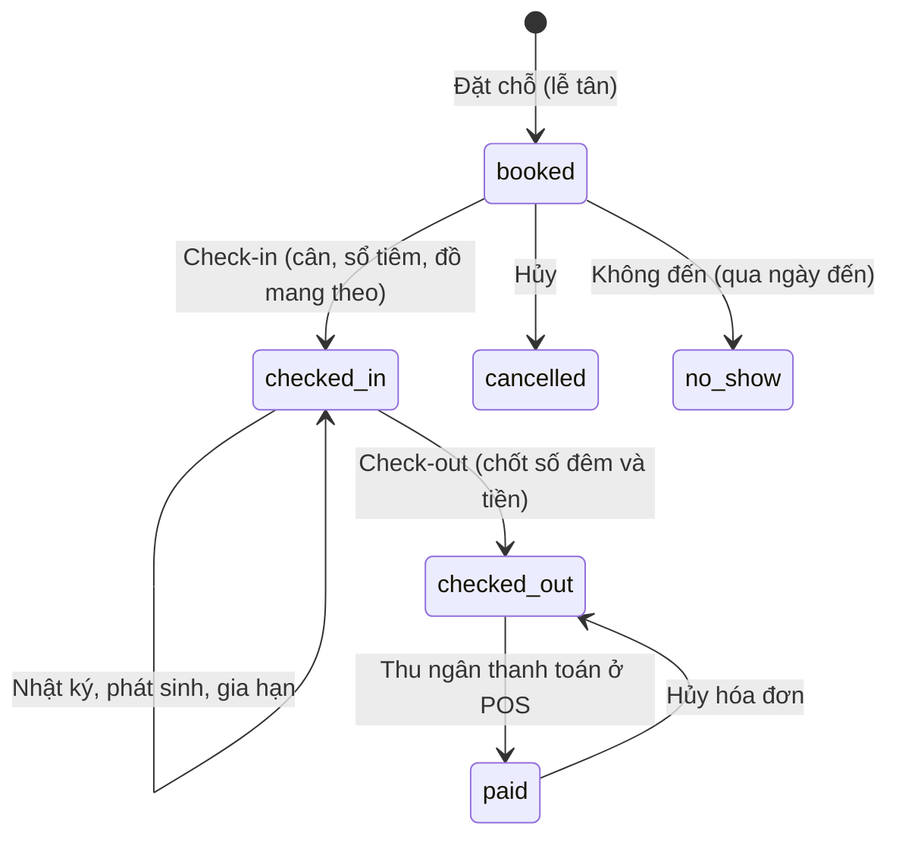

# Khách sạn thú cưng (lưu trú)

Kế hoạch module lưu trú: khách gửi thú ở lại cửa hàng qua đêm, nhân viên chăm sóc và ghi nhật ký, khách đón về và trả tiền tại quầy. Nguồn: kế hoạch BA/kiến trúc v0.3 (M8 Nội trú & Lưu trú, mục E, quy tắc 16 và 20, MoSCoW 2.3: lưu trú là **Should**). Module đứng sau POS (PR #43), RBAC theo (nhân viên, cơ sở) (PR #42), lịch hẹn spa (`docs/lich-hen-spa.md`), báo cáo doanh thu (`docs/bao-cao-doanh-thu.md`) và giao diện khách hàng (`docs/giao-dien-khach-hang.md`), đều đã merge.

**Tiến độ:** bước 1 (quyền, loại chuồng và giá, chuồng, quy định giờ, màn Cài đặt lưu trú) và bước 2 (đặt chỗ, sơ đồ chuồng, danh sách lượt) và bước 3 (nhận thú, gia hạn, nhật ký chăm sóc, phát sinh, trả chuồng, trang chi tiết lượt `/admin/boarding/detail/[stayId]`) và bước 4 (thanh toán lưu trú ở POS: hộp "Lưu trú chờ thanh toán", dòng hóa đơn `boarding`, hủy hóa đơn trả khoản phí về chưa thanh toán) và bước 5 (báo cáo: mảng Lưu trú ở thẻ cơ cấu, biểu đồ ngày, bảng ngày và xếp hạng) đã làm xong. Các bước còn lại chưa có code. Thứ tự làm ở mục 10.

Dự án là pet project cá nhân, chưa có doanh thu, nên phạm vi giữ ở mức một cơ sở vận hành được hằng ngày, thiết kế sẵn cho nhiều cơ sở, không tích hợp bên ngoài, không đặt cọc.

## 1. Trước và sau

**Trước:** hệ thống không có lưu trú. Không có danh mục chuồng, không biết chuồng nào trống đêm nào, không có giấy nhận thú (cân nặng, đồ mang theo, chế độ ăn), không có nhật ký chăm sóc, và tiền lưu trú phải gõ tay thành một dịch vụ lẻ trong POS.

**Sau:** lễ tân đặt chỗ cho một khách có sẵn: chọn thú, loại chuồng, ngày giờ đến và đi. Hệ thống tự xếp một chuồng còn trống cho cả khoảng ngày, tính tiền dự kiến theo số đêm, và từ chối nếu không còn chuồng. Màn sơ đồ chuồng cho thấy hôm nay chuồng nào trống, đang ở, sắp đến, sắp đi, quá hạn hoặc đang vệ sinh. Khi khách mang thú tới, lễ tân check-in: cân, xem sổ tiêm, ghi đồ mang theo và chế độ ăn. Trong thời gian ở, nhân viên ghi nhật ký ăn uống, đi dạo, cho thuốc, ghi chú; khách xem được nhật ký trên trang tài khoản. Phát sinh thêm (cho uống thuốc, đưa đón, tắm) được ghi vào lượt lưu trú. Khi khách đón, lễ tân check-out: hệ thống chốt số đêm, phụ thu trả muộn và các phát sinh, chuồng chuyển sang "đang vệ sinh". Thu ngân mở POS, kéo các khoản lưu trú của khách vào giỏ chung cùng hàng shop và phiếu spa, thanh toán một hóa đơn. Báo cáo doanh thu có thêm mảng **Lưu trú**.

## 2. Phạm vi

| Mức | Nội dung |
| --- | --- |
| **Must** | Loại chuồng (kích cỡ, loài nhận, cân tối đa, sức chứa) và giá mỗi đêm, có giá riêng theo cơ sở; chuồng theo cơ sở; quy định giờ nhận / trả theo cơ sở; đặt / sửa / gia hạn / hủy lượt lưu trú; nhiều thú trong một lượt, ở chung chuồng nếu loại chuồng cho phép; tự xếp chuồng và chặn trùng ở database; sơ đồ chuồng hôm nay; danh sách lượt lưu trú có tìm kiếm, lọc, phân trang, xuất file; check-in (cân nặng, sổ tiêm, đồ mang theo, chế độ ăn); nhật ký chăm sóc; phát sinh; check-out chốt tiền; đưa vào giỏ POS; hủy hóa đơn trả các khoản về chưa thanh toán; mảng Lưu trú trong báo cáo; khách xem lượt lưu trú và nhật ký của mình |
| **Should** | Lịch chuồng 14 ngày (chuồng × ngày) để xem chỗ trống; đổi chuồng cùng loại giữa chừng; trang giới thiệu khách sạn và bảng giá trên web; số lượt đến / đi hôm nay trên dashboard; cảnh báo thú có ghi chú hành vi hoặc dị ứng |
| **Could** | Ảnh trong nhật ký chăm sóc; in giấy nhận thú; kéo thả trên lịch chuồng; chốt tạm tiền cho lượt ở dài |
| **Won't (lần này)** | Khách tự đặt chỗ trên web (khách chỉ xem); đặt cọc / tạm ứng; nội trú điều trị (Phase 2 cùng Y tế, dùng lại bảng chuồng); sổ tiêm điện tử (chỉ đánh dấu "đã xem sổ tiêm"); nâng hạng chuồng giữa chừng có tính lại giá; camera; nhắc qua Zalo/SMS |

## 3. Luồng nghiệp vụ



1. **Đặt chỗ:** lễ tân tìm khách (dùng lại `search_customers`), chọn một hoặc nhiều thú của khách, mỗi thú chọn loại chuồng, ngày giờ đến và ngày giờ đi dự kiến. Hệ thống gợi ý loại chuồng hợp với loài và cân nặng gần nhất của thú, tự chọn chuồng trống cho cả khoảng ngày (lễ tân đổi được), hiện tiền dự kiến. Thú mới thêm ở màn Thú cưng trước (khách không tự thêm thú, theo quyết định ngày 2026-10-15).
2. **Check-in:** khi khách mang thú tới. Với mỗi thú: cân nặng thực tế (ghi vào `pet_weight_logs`), tích "đã xem sổ tiêm còn hạn" kèm ghi chú, đồ mang theo, chế độ ăn (thức ăn của khách hay của shop, số bữa, lượng), thuốc cần cho uống, SĐT liên hệ khẩn. Giá mỗi đêm được chốt lúc này.
3. **Trong thời gian ở:** nhân viên ghi nhật ký (bữa ăn, đi dạo, vệ sinh, cho thuốc, ghi chú) và thêm phát sinh từ danh mục dịch vụ. Gia hạn ngày đi nếu chuồng còn trống. Muốn tắm spa thì đặt lịch spa bình thường; phiếu spa thanh toán theo luồng spa sẵn có.
4. **Check-out:** hệ thống tính số đêm theo ngày thực tế, phụ thu trả muộn theo quy định giờ, cộng phát sinh, tạo các khoản cần thu. Chuồng chuyển sang "đang vệ sinh". Lễ tân trả lại đồ mang theo (đánh dấu đã trả).
5. **Thanh toán:** trong POS, chọn khách thì hiện "Lưu trú chờ thanh toán (n)" cạnh "Phiếu spa chờ thanh toán". Một hóa đơn gộp được lưu trú, phiếu spa và hàng shop (giỏ hàng gộp, hóa đơn theo chủ). Khi mọi khoản của lượt đã vào hóa đơn, lượt chuyển `paid`.
6. **Vệ sinh chuồng:** nhân viên bấm "Đã dọn" để chuồng về trống.

## 4. Mô hình dữ liệu

Bảng theo cơ sở có `branch_id not null`. Thời gian lưu `timestamptz`; ngày nghiệp vụ theo `public.business_date()` (giờ Việt Nam). Mã chứng từ `CS01-LT-000123` sinh bằng `next_doc_code(branch, 'LT')`.

| Bảng | Vai trò |
| --- | --- |
| `kennel_types` | Danh mục loại chuồng dùng chung mọi cơ sở (giống danh mục dịch vụ). |
| `kennel_type_prices` | Giá mỗi đêm theo loại chuồng; `branch_id` null là giá chung, có `branch_id` là giá riêng cơ sở (giống `pet_service_prices`, `product_branch_prices`). |
| `kennels` | Chuồng cụ thể của một cơ sở. |
| `boarding_settings` | Quy định giờ nhận / trả và phụ thu trả muộn của một cơ sở. |
| `boarding_stays` | Một lượt lưu trú của một khách tại một cơ sở (đầu phiếu). |
| `boarding_stay_pets` | Một thú trong lượt: chuồng, khoảng đêm, giá, thông tin nhận thú. |
| `boarding_care_logs` | Nhật ký chăm sóc theo từng thú. |
| `boarding_charges` | Các khoản cần thu: tiền đêm, phụ thu trả muộn, phát sinh. Gắn hóa đơn qua `invoice_line_id`. |

### `kennel_types`

| Cột | Ghi chú |
| --- | --- |
| `name`, `description`, `photo_url` | Ví dụ "Chuồng S (mèo, chó dưới 5 kg)", "Phòng VIP có điều hòa" |
| `species_ids uuid[]` | Loài được nhận; rỗng = mọi loài |
| `max_weight_kg` | Cân tối đa một thú; null = không giới hạn. Vượt thì cảnh báo, không chặn |
| `max_pets` | Số thú tối đa ở chung một chuồng (cùng một lượt, cùng chủ). Mặc định 1 |
| `purpose` | `boarding` (mặc định), để dành `medical`, `isolation` cho nội trú Phase 2 |
| `is_active`, `is_public`, `sort_order` | `is_public`: hiện trên bảng giá web |

### `kennel_type_prices`

`kennel_type_id`, `branch_id` (null = giá chung), `night_price` (thú thứ nhất trong chuồng), `extra_pet_night_price` (mỗi thú ở chung thêm; null = bằng `night_price`). `unique nulls not distinct (kennel_type_id, branch_id)`. Hàm `kennel_night_price(type, branch)` lấy giá cơ sở trước, giá chung sau.

Giá theo kích cỡ / loài đi qua **loại chuồng**: loại chuồng nhỏ nhận mèo và chó nhỏ, loại lớn nhận chó lớn, mỗi loại một giá. Không dùng bảng giá theo khung cân như spa, vì với lưu trú thứ tốn tiền là chuồng chứ không phải công làm, và bảng giá một chiều dễ nhập, dễ đọc cho khách hơn.

### `kennels`

| Cột | Ghi chú |
| --- | --- |
| `branch_id`, `kennel_type_id` | |
| `code`, `name` | `code` duy nhất trong cơ sở, ví dụ `S01`, `VIP2` |
| `status` | Trạng thái vật lý do người bấm: `ready`, `cleaning`, `maintenance`. "Đang có thú" không lưu ở đây mà suy ra từ `boarding_stay_pets` |
| `is_active`, `sort_order` | Ngừng dùng thay vì xóa khi đã có lịch sử |

### `boarding_settings` (một dòng mỗi cơ sở; thiếu dòng thì dùng mặc định)

| Cột | Mặc định | Ghi chú |
| --- | --- | --- |
| `check_in_from` | 08:00 | Giờ sớm nhất được nhận thú |
| `check_out_by` | 12:00 | Trả trước giờ này không bị phụ thu |
| `late_half_until` | 18:00 | Trả sau `check_out_by` và trước giờ này: phụ thu nửa đêm; sau giờ này: thêm một đêm |
| `max_nights` | 30 | Số đêm tối đa một lượt |
| `day_stay_nights` | 1 | Gửi trong ngày (đến và đi cùng ngày) tính bằng bấy nhiêu đêm (1 hoặc 0.5) |

### `boarding_stays`

| Cột | Ghi chú |
| --- | --- |
| `code`, `branch_id`, `customer_id` | Khách bắt buộc (hóa đơn theo chủ) |
| `customer_name`, `customer_phone` | Bản sao lúc đặt để danh sách đọc nhanh |
| `status` | `booked`, `checked_in`, `checked_out`, `paid`, `cancelled`, `no_show` |
| `planned_in_at`, `planned_out_at` | Giờ đến / đi dự kiến |
| `checked_in_at`, `checked_out_at` | Giờ thực tế |
| `source` | `counter`, `phone`; `web` để dành |
| `emergency_phone`, `note` | |
| `cancelled_at`, `cancel_reason`, `created_by`, `created_at`, `updated_at` | |

### `boarding_stay_pets`

| Cột | Ghi chú |
| --- | --- |
| `stay_id`, `branch_id` | `branch_id` chép từ lượt để RLS và ràng buộc không cần join |
| `pet_id`, `pet_name` | Thú phải thuộc khách (`pet_owners` còn hiệu lực) |
| `kennel_type_id`, `kennel_id` | Luôn có chuồng: RPC tự xếp lúc đặt |
| `nights` | `daterange` các đêm chiếm chuồng, nửa mở `[ngày đến, ngày đi)`. Gửi trong ngày dùng `[ngày, ngày + 1)` |
| `status` | `active`, `cancelled` (giải phóng chuồng) |
| `is_extra_pet` | Thú ở chung chuồng thứ hai trở đi, tính `extra_pet_night_price` |
| `est_night_price` | Giá dự kiến lúc đặt |
| `night_price` | Giá chốt lúc check-in; sau đó không đổi theo bảng giá |
| `weight_kg` | Cân lúc check-in |
| `vaccine_checked`, `vaccine_note` | Đã xem sổ tiêm còn hạn; chưa có sổ tiêm điện tử (Phase 2) |
| `belongings`, `belongings_returned` | Đồ mang theo (chữ tự do) và đã trả chưa |
| `feeding`, `medication` | Chế độ ăn, thuốc cần cho uống (chữ tự do) |

### Chặn trùng chuồng

Dùng exclusion constraint (extension `btree_gist` đã bật), nên hai lễ tân lưu cùng lúc cũng không xếp trùng được:

```sql
-- Một chuồng không chứa hai lượt khác nhau trong cùng một đêm.
-- Thú cùng một lượt được ở chung (stay_id giống nhau), số lượng do RPC kiểm theo max_pets.
exclude using gist (kennel_id with =, stay_id with <>, nights with &&)
  where (status = 'active')
-- Một thú không ở hai lượt chồng ngày.
exclude using gist (pet_id with =, nights with &&)
  where (status = 'active')
```

Khi check-out, `nights` được thu lại theo ngày đi thực tế, nên chuồng trống ngay cho lượt sau. Hủy hoặc không đến thì phiếu thú chuyển `cancelled`.

### `boarding_care_logs`

`stay_pet_id`, `branch_id`, `kind` (`meal`, `walk`, `potty`, `medication`, `note`), `meal_eaten` (`all`, `some`, `none`; chỉ với `meal`), `content`, `visible_to_customer` (mặc định true), `logged_at`, `created_by`. Không sửa, chỉ xóa trong 24 giờ bởi người viết hoặc người có `boarding: UPDATE`.

### `boarding_charges`

| Cột | Ghi chú |
| --- | --- |
| `stay_id`, `stay_pet_id`, `branch_id` | |
| `kind` | `night` (tiền đêm, một dòng mỗi thú), `late` (phụ thu trả muộn), `extra` (phát sinh) |
| `service_id` | Chỉ với `extra`: một dịch vụ trong danh mục `pet_services` (ví dụ "Cho uống thuốc", "Đưa đón", "Dắt đi dạo thêm") |
| `name`, `qty`, `unit_price`, `amount` | Tên và giá do database tính, không lấy từ client |
| `invoice_line_id` | Gắn khi vào hóa đơn; null lại khi hóa đơn bị hủy |
| `created_by`, `created_at` | |

Phát sinh được ghi ngay khi thêm (để khách thấy tạm tính); dòng `night` và `late` chỉ tạo khi check-out.

### Hóa đơn

`invoice_lines.item_type` thêm giá trị `boarding` (tiền đêm và phụ thu, không có `product_id` / `service_id` / `combo_id`). Khi làm thật, cả phát sinh cũng vào hóa đơn với `item_type = 'boarding'` (tên dòng kèm tên thú), nên báo cáo nhận ra mọi dòng lưu trú qua `item_type`; tên dòng trong báo cáo xếp hạng là hằng `boarding`, giao diện dịch. Trả hàng (`create_sales_return`) vẫn chỉ nhận dòng sản phẩm; tiền lưu trú hoàn bằng cách hủy hóa đơn, như phiếu spa.

## 5. Quy tắc nghiệp vụ

1. **Đếm đêm theo ngày, không theo giờ**: số đêm = ngày đi − ngày đến (theo `business_date`). Đến và đi cùng ngày = `day_stay_nights`. Trả sau `check_out_by` thì cộng nửa đêm, sau `late_half_until` thì cộng một đêm (dòng `late`). Check-out sớm hơn dự kiến thì tính theo ngày thực tế.
2. **Giá dự kiến lúc đặt, giá chốt lúc check-in**, như spa. Thú ở chung chuồng thứ hai trở đi tính `extra_pet_night_price`.
3. **Giờ hợp lệ**: giờ đến không trước `check_in_from`; ngày đi sau hoặc bằng ngày đến; không quá `max_nights`; không đặt vào quá khứ (trừ khi check-in ngay).
4. **Loại chuồng phải nhận loài của thú**; cân gần nhất hoặc cân lúc check-in vượt `max_weight_kg` thì cảnh báo (không chặn, vì cân có thể cũ).
5. **Ở chung chuồng** chỉ khi cùng lượt (cùng chủ) và tổng số thú không vượt `max_pets` của loại.
6. **Tự xếp chuồng**: RPC chọn chuồng `is_active`, không `maintenance`, cùng loại, không có lượt khác chồng đêm, theo `sort_order`. Không còn chuồng thì lỗi `no_kennel`. Chuồng `cleaning` vẫn xếp được cho lượt tương lai.
7. **Sửa / gia hạn**: lượt `booked` sửa được mọi thứ. Lượt `checked_in` chỉ đổi ngày đi dự kiến (gia hạn hoặc rút ngắn) và đổi chuồng sang chuồng **cùng loại** còn trống cho các đêm còn lại. Không đổi loại chuồng sau check-in (nâng hạng thì thêm phát sinh).
8. **Hủy** chỉ khi `booked`. **Không đến** chỉ khi `booked` và đã qua ngày đến dự kiến. Cả hai giải phóng chuồng.
9. **Check-in** bắt buộc nhập cân nặng từng thú. Chưa tích "đã xem sổ tiêm" thì hiện cảnh báo vàng và vẫn cho qua (quy tắc 20 BA: cảnh báo, không chặn).
10. **Check-out** chỉ khi `checked_in`. Chuồng các thú chuyển `cleaning`. Đồ mang theo chưa đánh dấu trả thì nhắc.
11. **Quá hạn**: lượt `checked_in` đã qua giờ đi dự kiến hiện đỏ trên sơ đồ. Nếu đêm tiếp theo chuồng đã có lượt khác đặt, sơ đồ báo "cần đổi chuồng" cho lượt sau.
12. **Thanh toán qua POS**: chỉ khoản của lượt `checked_out` (hoặc phát sinh của lượt đang ở, xem câu hỏi 3) chưa có `invoice_line_id`. Khoản phải thuộc khách của hóa đơn. Mọi khoản đã vào hóa đơn thì lượt `paid`; hủy hóa đơn thì lượt về `checked_out`.
13. **Thú có ghi chú hành vi / dị ứng** (`pets.behavior_notes`, `pets.allergies`) hiện nhãn trên sơ đồ và trang chi tiết.

## 6. RPC

Theo quy ước repo: nghiệp vụ nhiều bước trong Postgres function `security definer`, client chỉ đọc bảng qua RLS. Lỗi có `hint` để UI dịch ra tiếng Việt. Danh sách có tìm kiếm + trang + cỡ trang. Cột **Bước** là bước ở mục 10.

| RPC | Bước | Việc làm |
| --- | --- | --- |
| `save_kennel_type(p jsonb, p_id uuid default null)` | 1 | Thêm / sửa loại chuồng cùng giá chung và giá riêng các cơ sở |
| `list_kennel_types(p_branch, p_search, p_page, p_page_size)` | 1 | Loại chuồng kèm giá áp dụng tại cơ sở và số chuồng |
| `save_kennel(p jsonb, p_id uuid default null)` | 1 | Thêm / sửa / ngừng dùng chuồng. Không đổi loại khi chuồng có lượt chưa xong |
| `set_kennel_status(p_id, p_status)` | 1 | `ready` / `cleaning` / `maintenance`. Không cho `maintenance` khi đang có thú |
| `boarding_settings_get(p_branch)`, `save_boarding_settings(p_branch, p)` | 1 | Đọc / lưu quy định giờ |
| `kennel_night_price(p_type, p_branch)` | 1 | Giá đêm áp dụng (nội bộ) |
| `boarding_quote(p_branch, p jsonb)` | 2 | Tiền dự kiến và chuồng gợi ý cho các thú và khoảng ngày, chưa lưu. Dùng cho dialog đặt chỗ |
| `boarding_availability(p_branch, p_from date, p_to date)` | 2 | Số chuồng trống theo loại cho khoảng ngày |
| `save_boarding_stay(p jsonb, p_id uuid default null)` | 2 | Tạo / sửa lượt cùng các thú trong một transaction: kiểm khách, thú thuộc khách, loài, giờ, `max_nights`, `max_pets`; tự xếp hoặc kiểm chuồng đã chọn; chép giá dự kiến. Lỗi `hint`: `no_kennel` (kèm loại và đêm), `kennel_taken`, `pet_busy`, `species_not_allowed`, `too_many_pets`, `bad_dates`, `too_long`, `in_past`, `not_editable`, `no_customer`, `no_pet` |
| `cancel_boarding_stay(p_id, p_reason)` | 2 | Hủy lượt `booked` |
| `mark_boarding_no_show(p_id)` | 2 | Không đến, sau ngày đến dự kiến |
| `list_boarding_stays(p_branch, p_from, p_to, p_status, p_search, p_page, p_page_size)` | 2 | Bảng danh sách: tìm theo mã, tên khách (không dấu), SĐT, tên thú, mã chuồng; trả `{ rows, total }` |
| `get_boarding_stay(p_id)` | 2 | Một lượt đầy đủ: thú, chuồng, giá, nhật ký, khoản thu |
| `boarding_board(p_branch, p_date)` | 2 | Sơ đồ ngày: mọi chuồng với trạng thái hôm nay (trống, đang ở, đến hôm nay, đi hôm nay, quá hạn, vệ sinh, bảo trì) và thú trong đó |
| `boarding_timeline(p_branch, p_from, p_days)` | 2 (Should) | Lịch chuồng: các đoạn đêm đã đặt của mỗi chuồng trong `p_days` ngày (tối đa 31) |
| `check_in_boarding(p_id, p_pets jsonb)` | 3 | Mỗi thú: cân (ghi `pet_weight_logs`), sổ tiêm, đồ mang theo, ăn, thuốc; chốt `night_price`; chuyển `checked_in`. Check-in sớm hơn ngày dự kiến thì dời `nights` nếu chuồng trống |
| `extend_boarding_stay(p_id, p_planned_out_at)` | 3 | Gia hạn / rút ngắn lượt đang ở; lỗi `kennel_taken` nếu đêm thêm đã có lượt khác |
| `move_boarding_pet(p_stay_pet, p_kennel)` | 3 (Should) | Đổi sang chuồng cùng loại còn trống từ hôm nay |
| `add_care_log(p_stay_pet, p jsonb)`, `delete_care_log(p_id)` | 3 | Ghi / xóa nhật ký |
| `add_boarding_extra(p_stay_pet, p_service, p_qty)`, `remove_boarding_extra(p_id)` | 3 | Thêm / bỏ phát sinh; giá theo `get_service_price` với cân lúc check-in |
| `boarding_checkout_preview(p_id, p_at timestamptz default now())` | 3 | Các khoản sẽ thu nếu trả lúc này, chưa lưu |
| `check_out_boarding(p_id)` | 3 | Tạo dòng `night` / `late`, thu `nights` về ngày đi thực tế, chuồng → `cleaning`, lượt → `checked_out` |
| `billable_boarding_charges(p_branch, p_customer)` | 4 | Khoản chưa thanh toán của khách, nhóm theo lượt, cho POS |
| `create_invoice` / `cancel_invoice` (sửa) | 4 | Nhận dòng `{ type: 'boarding_charge', id }`: đọc giá từ khoản thu, kiểm khách, ghi `invoice_line_id`, cập nhật trạng thái lượt; hủy hóa đơn gỡ liên kết. Bản sao bản mới nhất (`20261015040500_create_invoice_units.sql` và bản `cancel_invoice` mới nhất) cộng phần lưu trú |
| `report_sales_lines` (sửa) và các hàm tổng quan | 5 | Mảng `boarding` cho dòng có trong `boarding_charges`; tổng quan trả thêm `segments.boarding` |
| `my_boarding_stays(p_scope, p_page, p_page_size)` | 6 | Lượt lưu trú của khách đang đăng nhập (`upcoming` / `current` / `past`), kèm tạm tính |
| `my_boarding_stay(p_id)` | 6 | Một lượt của khách cùng nhật ký `visible_to_customer` |
| `boarding_public_catalog(p_branch)` | 6 (Should) | Loại chuồng `is_public` và giá, quy định giờ, cho trang web |

## 7. Phân quyền

Thêm quyền `boarding` (module "Lưu trú") với các method `VIEW`, `CREATE`, `UPDATE`, `DELETE`, `SETTING`, `EXPORT`, `ALL`; kiểm tra theo cơ sở bằng `has_permission('boarding', method, branch)`, bọc trong `can_boarding(method, branch)` như `can_pos`.

| Việc | Quyền |
| --- | --- |
| Xem sơ đồ, danh sách, chi tiết | `boarding: VIEW` |
| Đặt chỗ, check-in, ghi nhật ký, thêm phát sinh | `boarding: CREATE` |
| Sửa, gia hạn, đổi chuồng, check-out, không đến, đổi trạng thái chuồng | `boarding: UPDATE` |
| Hủy lượt, xóa nhật ký của người khác | `boarding: DELETE` |
| Loại chuồng, giá, chuồng, quy định giờ | `boarding: SETTING` |
| Xuất file danh sách | `boarding: EXPORT` |
| Kéo khoản lưu trú vào hóa đơn | `pos: CREATE` (như phiếu spa) |

Seed: `admin` = `ALL`; `cashier` = `VIEW`, `CREATE`, `UPDATE`. Người chỉ chăm sóc thì grace tạo vai trò riêng với `VIEW` + `CREATE`.

RLS: các bảng lưu trú chỉ đọc từ client với `boarding: VIEW` tại cơ sở đó; `kennel_types` và `kennel_type_prices` đọc được bởi mọi nhân viên (danh mục dùng chung). Mọi ghi đi qua RPC. Khách không đọc bảng trực tiếp, chỉ qua `my_boarding_stays` / `my_boarding_stay`.

## 8. Màn hình

### Admin

Theo quy ước admin: theme teal, `PagedTableCard` cho bảng, `AppDialog` cho modal, `SearchView` + `useListFilters` cho thanh tìm kiếm (debounce 500ms), `ExportMenu` để xuất file, `ContentWrap` tối đa 1600px. Menu mới nhóm "Lưu trú" trong `src/lib/navigations.ts`, quyền trang trong `ADMIN_ROUTE_PERMISSIONS` (`src/lib/access.ts`).

| Màn | Đường dẫn | Nội dung |
| --- | --- | --- |
| Sơ đồ chuồng | `/admin/boarding` (`boardingBoard`) | Lưới thẻ chuồng nhóm theo loại, tô màu theo trạng thái hôm nay; thẻ hiện mã chuồng, tên thú, chủ, ngày đi, nhãn quá hạn / hành vi. Thanh trên: chọn ngày, Hôm nay, đếm "Đến hôm nay / Đi hôm nay / Đang ở / Trống". Bấm chuồng trống mở dialog đặt chỗ với chuồng điền sẵn; bấm chuồng có thú mở trang chi tiết; chuồng `cleaning` có nút "Đã dọn". Tải lại khi focus và mỗi 60 giây (`usePolling`) |
| Lịch chuồng (Should) | Tab trên Sơ đồ chuồng | Hàng = chuồng, cột = 14 ngày, các đoạn đêm tô theo trạng thái. Lưới CSS tự dựng như Lịch spa, không thư viện |
| Danh sách lượt lưu trú | `/admin/boarding/stays` (`boardingStays`) | Bảng: mã, khách, thú, chuồng, ngày đến / đi, số đêm, tạm tính, trạng thái. Lọc khoảng ngày và trạng thái, tìm kiếm, xuất Excel/CSV/PDF |
| Dialog đặt / sửa | | Tìm khách → chọn thú (chỉ thú của khách) → mỗi thú chọn loại chuồng (gợi ý theo loài, cân) → ngày giờ đến / đi → chuồng gợi ý (đổi được) → ăn, đồ mang theo, ghi chú. Tạm tính từ `boarding_quote`. Lỗi `no_kennel` chỉ rõ loại và đêm hết chỗ |
| Chi tiết lượt | `/admin/boarding/stays/[id]` (`boardingStayDetail`) | Trang riêng vì nội dung dài: đầu trang (khách, trạng thái, nút theo trạng thái: Check-in, Gia hạn, Check-out, Hủy, Không đến, "Thanh toán tại POS"); thẻ từng thú (chuồng, cân, sổ tiêm, ăn, thuốc, đồ mang theo); tab Nhật ký (dòng thời gian, form ghi nhanh: loại, ăn hết / một phần / không ăn, nội dung, hiện cho khách); tab Phát sinh; tab Tiền (tạm tính hoặc các khoản đã chốt, hóa đơn) |
| Dialog check-in | | Mỗi thú: cân (bắt buộc), tích sổ tiêm + ghi chú, đồ mang theo, ăn, thuốc, SĐT khẩn. Cảnh báo vượt cân, chưa xem sổ tiêm |
| Dialog check-out | | Xem trước các khoản (`boarding_checkout_preview`), danh sách đồ mang theo để tích đã trả, xác nhận |
| Cài đặt lưu trú | `/admin/boarding/settings` (`boardingSettings`) | Tab Loại chuồng & giá (bảng + dialog: loài nhận, cân tối đa, sức chứa, giá chung, giá riêng cơ sở, hiện trên web), tab Chuồng (bảng theo cơ sở: mã, loại, trạng thái, thứ tự, ngừng dùng), tab Quy định giờ |
| POS | `/admin/pos` | Chọn khách thì hiện "Lưu trú chờ thanh toán (n)" cạnh ô phiếu spa; bấm Thêm / Thêm tất cả. Dòng lưu trú giá cố định, không đổi số lượng |
| Báo cáo | `/admin/reports` | Thẻ cơ cấu doanh thu thêm dòng "Lưu trú"; biểu đồ theo ngày thêm chuỗi Lưu trú |

### Khách hàng (chỉ xem)

| Màn | Đường dẫn | Nội dung |
| --- | --- | --- |
| Lưu trú của tôi | `/account/boarding` (`account-boarding`), mục mới trong `ACCOUNT_NAV` | Tab Sắp tới / Đang ở / Đã xong; thẻ lượt: thú, loại chuồng, ngày đến / đi, trạng thái, tạm tính hoặc tổng tiền. Không có nút đặt, sửa, hủy; có dòng "Muốn đặt chỗ? Gọi cửa hàng" kèm SĐT |
| Chi tiết lượt | `/account/boarding/[id]` | Nhật ký chăm sóc dạng dòng thời gian theo ngày (chỉ mục `visible_to_customer`), chế độ ăn, phát sinh, tạm tính |
| Tổng quan tài khoản | `/account` | Thêm ô "Đang lưu trú" khi có lượt `checked_in` |
| Giới thiệu khách sạn (Should) | `/boarding` | Ảnh, loại chuồng và giá mỗi đêm, quy định giờ, yêu cầu sổ tiêm, nút gọi / nhắn. Dùng component shop có sẵn (`SectionHeading`, `PriceDisplay`, `ShopImage`, `EmptyState`) và quy tắc SSR prefetch (`useServerPrefetch`) |

### Cấu trúc file (quy tắc tách file)

Mỗi màn là trang mỏng trong `src/pages/...` gọi view trong `src/views/admin/boarding/...`; dưới 300 dòng mỗi file. Ví dụ:

```
src/types/boarding.ts                     kiểu dữ liệu
src/repositories/boarding.ts              gọi RPC (tách boardingSettings.ts nếu dài)
src/queries/boarding.ts                   khóa và query Vue Query
src/views/admin/boarding/board/           Index.vue, KennelCard.vue, BoardStats.vue, useBoardingBoard.ts, boardStatus.ts
src/views/admin/boarding/timeline/        Index.vue, TimelineRow.vue, timelineLayout.ts
src/views/admin/boarding/stays/           Index.vue, StayRow.vue, StayFilterFields.vue, useStayFilters.ts, staysExportColumns.ts, useStaysExport.ts
src/views/admin/boarding/stay-dialog/     StayDialog.vue, StayPetFields.vue, useStayDraft.ts, stayDraft.ts
src/views/admin/boarding/detail/          Index.vue, StayHeader.vue, PetCard.vue, CareLogTab.vue, CareLogForm.vue, ExtrasTab.vue, ChargesTab.vue,
                                          CheckInDialog.vue, CheckOutDialog.vue, ExtendDialog.vue, useStayDetail.ts, useStayActions.ts
src/views/admin/boarding/settings/        Index.vue, KennelTypesCard.vue, KennelTypeDialog.vue, KennelsCard.vue, KennelDialog.vue, RulesCard.vue
src/views/admin/boarding/format.ts        nhãn trạng thái, đếm đêm hiển thị
src/views/client/account/boarding/        Index.vue, components/StayCard.vue, components/CareTimeline.vue, useMyBoarding.ts
```

## 9. Trường hợp biên

| Tình huống | Cách xử lý |
| --- | --- |
| Hai lễ tân xếp cùng chuồng cùng lúc | Exclusion constraint chặn; RPC bắt lỗi và thử chuồng khác một lần, hết thì `no_kennel` |
| Cùng một thú đặt hai lượt chồng ngày | Constraint `pet_id` chặn, lỗi `pet_busy` |
| Khách đón muộn hơn ngày đi dự kiến mà chuồng đêm sau đã có lượt khác | Sơ đồ báo quá hạn; lễ tân gia hạn (lỗi `kennel_taken`) thì đổi chuồng lượt sau hoặc lượt này sang chuồng cùng loại khác. Check-out vẫn tính đủ đêm thực tế |
| Khách đón sớm | Tính theo ngày thực tế, các đêm còn lại được trả cho chuồng |
| Khách đến sớm hơn ngày đặt | Check-in dời `nights` về hôm nay nếu chuồng trống, không thì lỗi để lễ tân chọn chuồng khác |
| Gửi trong ngày | Một đêm hoặc nửa đêm theo `day_stay_nights` |
| Thú không thuộc khách / đã đổi chủ | Lỗi `no_pet`, như POS và spa |
| Loài không hợp loại chuồng | Lỗi `species_not_allowed`; vượt cân chỉ cảnh báo |
| Chuồng chuyển `maintenance` khi đã có lượt tương lai | Chặn nếu đang có thú; nếu chỉ có lượt tương lai thì cho và hiện danh sách lượt cần đổi chuồng |
| Ngừng dùng loại chuồng / chuồng | Ẩn khỏi đặt mới; lượt cũ giữ nguyên |
| Đổi giá sau khi đặt | Lượt đã check-in giữ giá chốt; lượt `booked` lấy giá mới lúc check-in (tạm tính có thể đổi) |
| Hủy hóa đơn có tiền lưu trú | Khoản về chưa thanh toán, lượt về `checked_out`, thu lại ở hóa đơn khác |
| Thú ốm hoặc gặp sự cố khi đang ở | Ghi nhật ký loại `note` (có thể ẩn với khách), gọi SĐT khẩn. Điều trị thuộc Y tế Phase 2 |
| Khách không đến | Sau ngày đến dự kiến, lễ tân bấm "Không đến"; chuồng được giải phóng. Không tự động, không phạt |
| Phiếu spa trong lúc lưu trú | Đặt lịch spa thường; POS hiện cả hai ô chờ thanh toán, thu chung một hóa đơn |
| Nhiều cơ sở | Chuồng, lượt, quy định, nhật ký theo `branch_id`; loại chuồng dùng chung, giá riêng theo cơ sở. Không chuyển thú giữa cơ sở |
| Lượt ở dài, khách muốn trả trước một phần | Chưa hỗ trợ (Could: chốt tạm). Tạm thời thu một lần khi check-out |
| Múi giờ | Ngày tính bằng `business_date()` giờ Việt Nam, không theo giờ máy |

## 10. Thứ tự làm (mỗi bước một PR)

Migration đánh số `20261020*`, chạy tự động khi merge (workflow `Supabase migrate`), chỉ thêm file mới, chạy lại được an toàn. Bản gộp để dán vào SQL Editor (dự phòng) đặt ở `/mnt/project-files/pet-care-plan/migration-luu-tru-*.sql`.

| Bước | Nội dung | Migration |
| --- | --- | --- |
| 1 | Quyền `boarding`, `can_boarding`; bảng `kennel_types`, `kennel_type_prices`, `kennels`, `boarding_settings` + RLS; RPC cài đặt; màn **Cài đặt lưu trú** (3 tab); menu và quyền trang | `20261020010000_boarding_schema.sql`, `20261020010100_boarding_settings_rpcs.sql` |
| 2 | Bảng `boarding_stays`, `boarding_stay_pets` + constraint + RLS; `boarding_quote`, `boarding_availability`, `save_boarding_stay`, `cancel_boarding_stay`, `mark_boarding_no_show`, `list_boarding_stays`, `get_boarding_stay`, `boarding_board`; màn **Sơ đồ chuồng**, **Danh sách lượt** (tìm kiếm, lọc, xuất file), **Dialog đặt / sửa** | `20261020020000_boarding_stays.sql`, `20261020020100_boarding_booking.sql`, `20261020020200_boarding_views.sql` |
| 3 | Bảng `boarding_care_logs`, `boarding_charges`; check-in, gia hạn, nhật ký, phát sinh, xem trước và check-out, chuồng `cleaning` → `ready`; trang **Chi tiết lượt** với các dialog | `20261020030000_boarding_care.sql`, `20261020030100_boarding_check_in_out.sql` |
| 4 | `invoice_lines.item_type` thêm `boarding`; `billable_boarding_charges`; sửa `create_invoice` / `cancel_invoice`; ô "Lưu trú chờ thanh toán" trong POS | `20261020040000_boarding_billing.sql`, `20261020040100_pos_invoice_boarding.sql` |
| 5 | Báo cáo: mảng `boarding` trong `report_sales_lines` và tổng quan; thẻ cơ cấu và biểu đồ ngày thêm Lưu trú | `20261020050000_reports_boarding_segment.sql` |
| 6 | Phía khách: `my_boarding_stays`, `my_boarding_stay`, trang **Lưu trú của tôi** + chi tiết, ô trên tổng quan tài khoản; (Should) `boarding_public_catalog` và trang `/boarding` | `20261020060000_my_boarding.sql`, `20261020060100_boarding_public_catalog.sql` |
| 7 (Should) | Lịch chuồng 14 ngày (`boarding_timeline`), đổi chuồng cùng loại (`move_boarding_pet`), số đến / đi hôm nay trên dashboard | `20261020070000_boarding_timeline_move.sql` |

Mỗi bước: kiểm SQL trên Postgres cục bộ (chạy hai lần để chắc chạy lại được), `typecheck` và `build` cho UI, ghi vào mục "những gì cần biết" của tài liệu này khi xong. Hàm `create_invoice` / `cancel_invoice` ở bước 4 phải chép từ bản mới nhất đang có trong `supabase/migrations` (tìm `create or replace function public.create_invoice` ở file số lớn nhất), không từ bản cũ.

Việc đầu tiên sau bước 1: vào **Lưu trú → Cài đặt**, thêm loại chuồng và giá, thêm chuồng, chỉnh quy định giờ. Thêm vài dịch vụ phát sinh (ví dụ "Cho uống thuốc", "Đưa đón") trong danh mục dịch vụ nếu cần.

## 11. Mặc định đã chọn

- Nhân viên đặt chỗ (tại quầy, qua điện thoại); khách chỉ xem trên web, như quyết định thú cưng ngày 2026-10-15.
- Giá theo loại chuồng mỗi đêm, có giá riêng cơ sở; thú ở chung có giá riêng.
- Đếm đêm theo ngày; nhận từ 08:00, trả trước 12:00, trả muộn đến 18:00 tính nửa đêm, sau đó một đêm; gửi trong ngày tính một đêm; tối đa 30 đêm.
- Tự xếp chuồng ngay lúc đặt; không đặt theo "loại" rồi xếp sau.
- Sổ tiêm chỉ là ô tích + ghi chú, cảnh báo không chặn.
- Phát sinh lấy từ danh mục `pet_services`, không gõ giá tay.
- Không đặt cọc, không thu trước, không nhắc lịch tự động.
- Bảng chuồng có cột `purpose` để nội trú điều trị Phase 2 dùng chung.

## 12. Câu hỏi cần chốt

Chưa có trả lời thì làm theo mặc định trong ngoặc:

1. Trả muộn tính thế nào? (mặc định: sau 12:00 nửa đêm, sau 18:00 một đêm; chỉnh được trong Cài đặt)
2. Gửi trong ngày (sáng gửi, chiều đón) tính một đêm hay nửa đêm? (mặc định: một đêm; chỉnh được)
3. Phát sinh của lượt đang ở có được thu trước khi check-out không? (mặc định: không, thu tất cả lúc check-out)
4. Thú ở chung chuồng tính giá thế nào? (mặc định: giá riêng `extra_pet_night_price` theo loại chuồng, để trống thì bằng giá thường)
5. Có yêu cầu đặt cọc cho lượt dài hoặc dịp lễ không? (mặc định: không, Won't)
